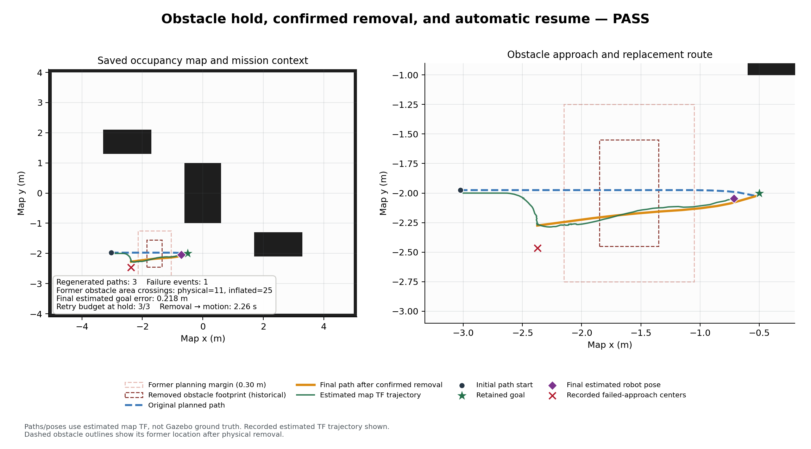

# 갑작스러운 장애물과 재계획·대기·재개 시험

2026-10-29에 로컬 Gazebo만 사용했습니다. 실차 도메인 16과 운용 웹 8790의 프로세스를
재시작하거나 제어하지 않았습니다. 시험은 도메인 **185**, localhost 통신,
Gazebo **11585**에서 진행했고 `simulation_room.world`와 저장 지도를 사용했습니다.

로봇이 실제로 0.25m 이상 움직이고 초기 경로가 발행된 뒤 저장 지도에 없던
**충돌 형상·라이다 반사면을 가진 0.5 × 0.9 × 1m 상자**를 생성했습니다.
목표는 `(-0.5, -2.0)`입니다. 실패 이벤트나 센서 영상을 합성해 넣지 않았습니다.

## 최종 판정

| 항목 | 판정 | 실제 측정 |
|---|---|---|
| 경로와 무관한 장애물 | 합격 | 최종 소스로 약 11.41초 도착, 생성 후 재계획 0회, 목표 오차 0.221m |
| 막힌 경로를 다른 길로 계속 우회해 완주 | **불합격** | 기존 DWB, 실패 기억, RotationShim 비교, 비용 가중치 비교 모두 정체 |
| 기본 3회 시도 후 대기 | 합격 | 26.804초에 `OBSTACLE_HOLD`, 횟수 3/3 |
| 대기 중 실제 정지 유지 | 합격 | 3.005초 동안 최종 명령 78개 모두 선속도·각속도 0 |
| 대기 중 실제 odom 이동 | 합격 | 510개 표본, 최대 변위 0.000335m |
| 실제 장애물 삭제 후 제거 확인 | 합격 | 30.559초에 상자 삭제, 2.258초 뒤 자동 명령 재개 |
| 같은 목표 유지와 최종 도착 | 합격 | 총 59.050초, Nav2 성공, 지도 추정 목표 오차 0.218m |
| AMCL 갱신 감시 | 합격 | 실제 갱신 요청·응답 16회, 최종 상태 정상, 정지 잠금 없음 |

**장애물이 남아 있는 상태의 우회 완주와, 장애물 제거를 기다린 뒤 재개한 시험은 다릅니다.**
59초 결과를 기존 150초 실패보다 주행 성능이 빨라졌다는 비교로 해석하지 않습니다.
최종 정책은 무한 재시도 대신 정지·안내·제거 확인·목표 재개를 검증한 것입니다.

- [최종 원본 JSON](obstacle_hold_remove_final_trial.json)
- [경로와 무관한 장애물 최종 JSON](unrelated_obstacle_final_trial.json)
- [구현·파라미터·복귀 방법](../../docs/FAILURE_REPLANNING.md)



## 경로 타당성에서 확인한 한계

초기에 라이다로 보이는 상자의 앞면만 반영되면 가려진 뒷모서리의 실제 형상은 아직
알 수 없습니다. 생성된 경로의 중심선은 상자 내부를 지나지 않았지만, 일부 우회 후보는
전체 상자의 실제 형상에 더한 0.30m 여유와 겹쳤습니다. 따라서 경로가 발행됐다는 이유로
안전한 우회 경로라고 합격 처리하지 않았습니다.

Nav2의 장애물·충돌 검사와 기존 속도 제한은 유지했습니다. 최종 정책에서는 진입한
새 경로가 다시 막히는 경우도 한 시도로 세며, 같은 센서 프레임을 여러 번 세지 않습니다.
세 번 진행하지 못하면 목표를 유지한 채 대기합니다.

장애물 제거는 TTL 만료가 아니라 측정 시각 TF로 투영한 실제 라이다의 빈 공간 증거를
연속 2초 확인합니다. 가까운 셀로 장애물 반사점이 이동한 경우도 제거로 오인하지 않도록
주변 약 0.10m의 현재 반사점을 함께 확인합니다. 수동 조작·정지·센서 불량 중에는
제거 확인 시간이 누적되지 않습니다.

## 실패 기록과 수정

| 기록 | 결과·발견 |
|---|---|
| `unseen_obstacle_trial.json` | 150초 실패. 11회 재계획에도 실제 실패 접근이 기록되지 않음 |
| `unseen_obstacle_fixed_trial.json` | 150초 실패. 실패 감지는 작동했으나 DWB 추종 정체 유지 |
| `unseen_obstacle_rotation_shim_trial.json` | 150초 실패. 선회 정렬 보조만으로 해결되지 않음 |
| `unseen_obstacle_cost_trial.json` | 120초 실패. 장애물·정렬 비용 변경만으로 해결되지 않음 |
| `obstacle_hold_remove_trial.json` | 부분 이동으로 시도 횟수가 초기화되는 문제. 중도 종료 이유 보존 |
| `obstacle_hold_remove_fixed_trial.json` | 새 경로가 2초 이내 취소되면 긴 정체 판정에 도달하지 않는 문제 |
| `obstacle_hold_remove_callbacks_trial.json` | 3회 대기·제거·재개는 성공. 재개 후 AMCL 실제 갱신 지연으로 정지 |
| `obstacle_hold_remove_final_trial.json` | 최종 대기·제거 확인·같은 목표 재개·도착 모두 합격 |

실패 시도도 삭제하지 않았습니다. 각 JSON과 실행 로그, 경로 그림을 이 폴더에 함께
보관했습니다. RotationShim과 비용 변경은 채택하지 않았으며 기존 속도·가속도·DWB
튜닝값은 그대로입니다. AMCL에는 정상 센서·실제 움직임 조건에서 실제 필터 갱신만
요청하고, 요청·응답만으로 위치 시각이나 4초 감시 시간을 초기화하지 않습니다.

## 소프트웨어 검증

- ROS 패키지 검사 1,050개 통과
- 조종기 검사 59개 통과
- 웹 JavaScript 검사 6개 통과
- 기존 작업공간의 설치 경로를 건드리지 않은 별도 일반 `colcon build` 성공
- 새 설치 폴더에서 실패 기억·정체 판정·장애물 대기 모듈을 실제로 import 확인

## 같은 시험 다시 실행하기

README의 Humble 의존성과 작업공간 빌드를 먼저 완료합니다. 실행 중인 같은 시험이
없을 때 각 터미널에 입력합니다. 물리 로봇 도메인에서는 실행하지 않습니다.

```bash
# 터미널 1: 시험 전용 Gazebo
cd ~/Team2_workspace/src/SMART-VISION-AMR
source /opt/ros/humble/setup.bash
source ~/Team2_workspace/install/setup.bash
export ROS_DOMAIN_ID=185 ROS_LOCALHOST_ONLY=1
export GAZEBO_MASTER_URI=http://127.0.0.1:11585
source scripts/dds_env.bash
ros2 launch smart_vision_amr simulation.launch.py gui:=false use_rviz:=false
```

```bash
# 터미널 2: 실제 장애물을 넣고 대기·삭제·자동 재개·도착 판정
cd ~/Team2_workspace/src/SMART-VISION-AMR
source /opt/ros/humble/setup.bash
source ~/Team2_workspace/install/setup.bash
export ROS_DOMAIN_ID=185 ROS_LOCALHOST_ONLY=1
export GAZEBO_MASTER_URI=http://127.0.0.1:11585
source scripts/dds_env.bash
python3 tools/verify_failure_replanning.py --scenario blocking_hold_remove \
  --output /tmp/obstacle_hold_new_trial.json --timeout 150
```

출력 파일이 이미 있으면 덮어쓰지 않습니다. 다른 이름을 사용하세요. 끝난 뒤 터미널 1을
`Ctrl+C`로 종료합니다. 시험 도구는 생성한 자기 상자와 자기 목표만 정리합니다.

## 판정 범위

위치는 지도 TF와 오도메트리의 추정치입니다. Gazebo 정답 위치의 정확도 시험이나
접촉 센서로 무충돌을 증명한 시험은 아닙니다. 단일 상자의 단발 조건이며 여러 이동체,
라이다 높이 아래 장애물, 실제 로봇의 제동 거리·통신 품질은 별도 검증이 필요합니다.
