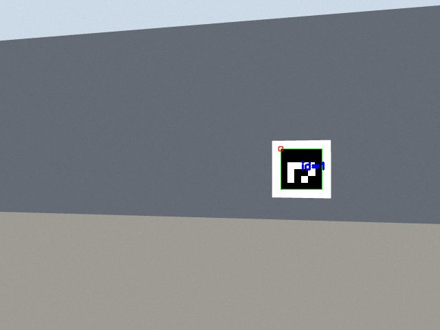
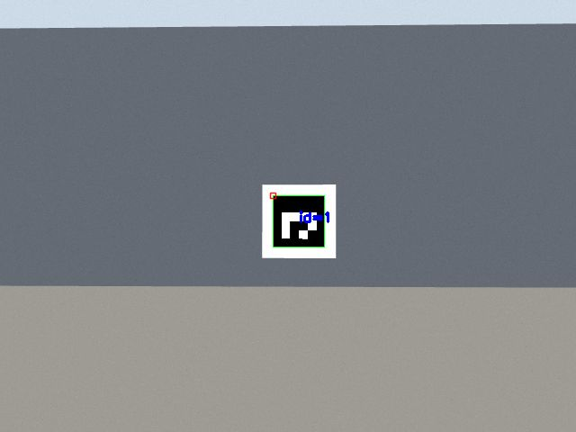
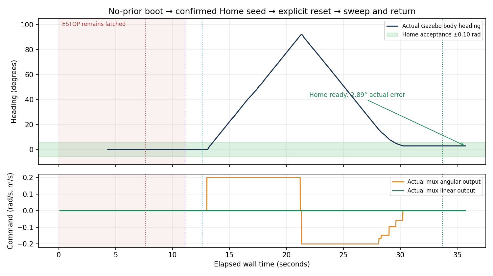
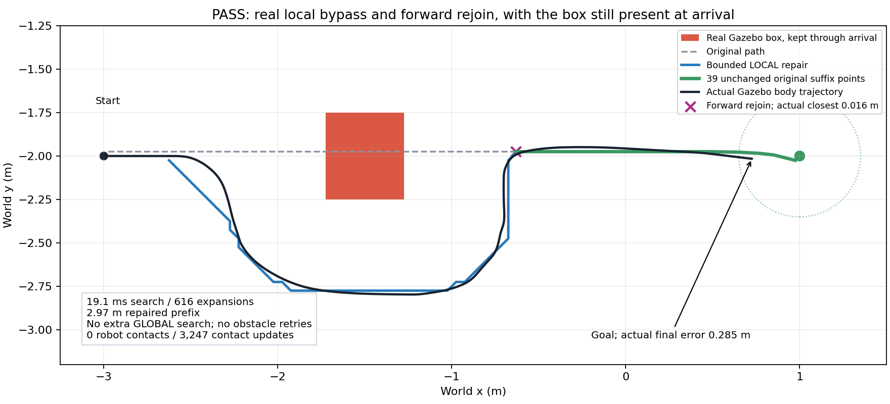
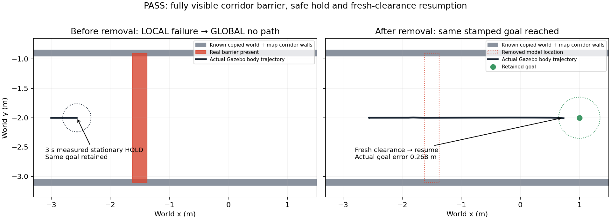
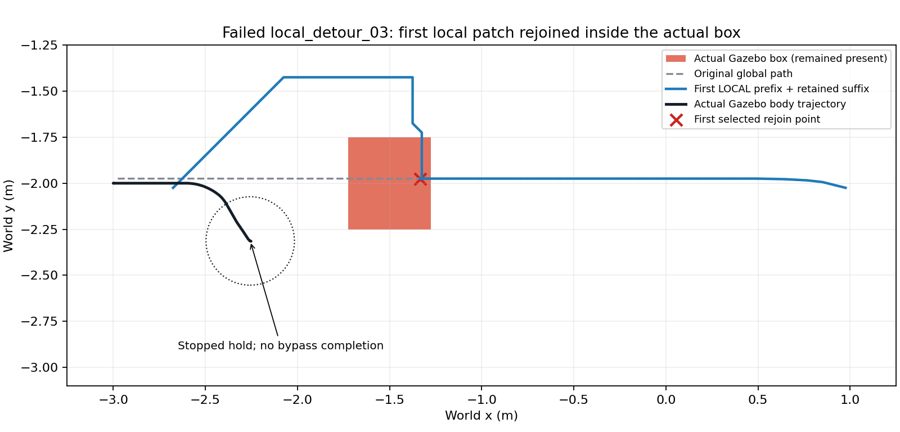
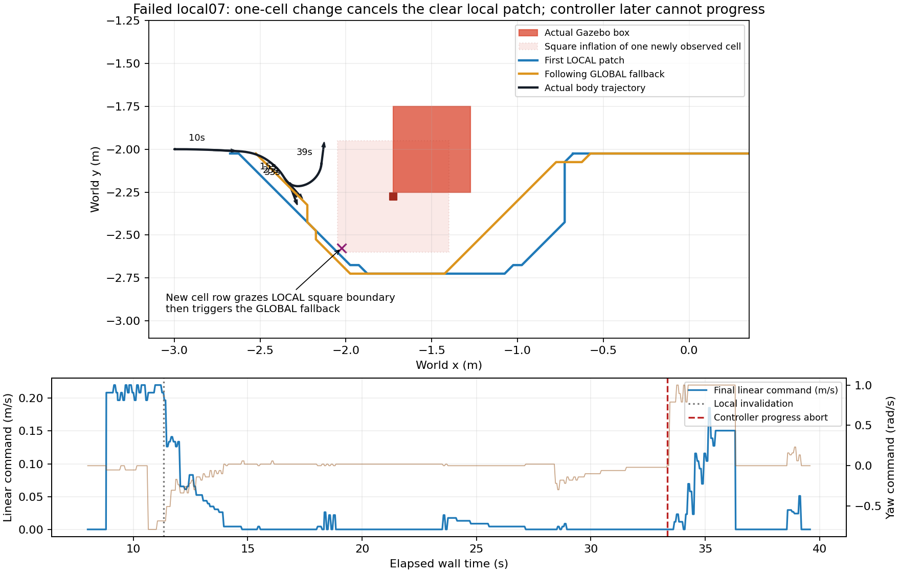

# 2026-10-30 시작·위치 확인·후방 정렬·국소 우회 Gazebo 검증

실제 Gazebo 물리·LiDAR·카메라·AMCL·Nav2와 웹·속도 mux를 사용한 로컬 시험입니다.
시험마다 소스를 `/tmp`의 별도 작업공간으로 복사해 빌드했습니다.
ROS 도메인 **186**, `ROS_LOCALHOST_ONLY=1`, Gazebo **11586**, 웹 **8796**만 사용했습니다.
실차 도메인 16, 운용 웹 8790, 팀원의 설치 작업공간과 서비스는 조작하지 않았습니다.

| 시험 | 판정 | 확인한 내용 |
|---|---|---|
| 독립 EKF 실제 목표 주행 | 합격 | 실제 경로·최종 속도 출력·odom 변위 1.782m·Nav2 성공·최종 지도상 목표 거리 0.231m |
| 최신 baseline 시작/위치 확인/장애 복구 | 합격 | 31개 검사, 실제 AMCL 정지 수렴·저속 회전, scan/TF 장애 정지·복구·명시적 재출발과 실제 도착. 최종 Home 방향 복귀는 별도 시험 |
| 갑자기 나타난 실제 박스의 국소 우회 | 합격 | 전역 탐색 추가 없이 짧은 국소 경로·원래 suffix 재합류·박스를 남긴 채 실제 도착·충돌 0 |
| 전폭 차단물의 정지·복구 | 합격 | 국소 실패 뒤 실제 전역 탐색·안전 대기·차단물 제거 후 같은 목표 도착 |
| 초기 위치 없는 부팅에서 등록 홈 초기화 | 합격 | 사전 AMCL 자세·map TF 0건, 정지 유지 홈 입력→명시적 해제→회전·홈 방향 복귀, 실제 오차 2.889도·home_ready 확인 |
| 실제 후방 카메라·벽 방향 정밀 정렬 | 합격 | 최종 소스의 ID1 실제 영상·5회 벽 측정·정지 확인, 실제 벽 직각 오차 1.202도, 가로 중앙 오차 0.03594 |
| 시작 복구 안내 화면 | 합격, 브라우저 모의 시험 | 1440px/390px 화면 넘침 없음, 안내 열기·체크박스로 POST 0건, 홈 확인·정지 버튼·키보드 초점 확인 |
| 최종 자동 검사·패키지 빌드 | 합격 | pytest 1,377개·웹 검사 7개·셸 구문 31개, 별도 임시 작업공간 빌드 성공 |

국소 우회와 전폭 차단물 시험은 최신 운영 소스 복사본으로 합격했습니다.
등록 Home 방향으로 돌아와 배송 출발 조건을 만족하는 최종 홈 초기화도 합격했습니다.
후방 정렬도 최종 소스 복사본으로 재시험해 합격했습니다. 아래 판정은 각 시험의
유한한 시나리오와 코드 버전에 한정하며, 이전 실패는 별도로 보존했습니다.

[최종 자동 검사 기록](final_validation.json)은 모든 Gazebo 시험을 종료한 뒤 실행했습니다.
pytest는 49.82초에 1,377개 통과, 실패·건너뛰기 0개였습니다. 실제 ROS 테스트 문맥은
도메인 223·localhost로 격리했고, 패키지 빌드는 별도 `/tmp`에서 수행했습니다.
설치된 Python 모듈 38개의 내용이 현재 소스와 일치하는 것도 확인했습니다.

[전체 판정과 코드 해시](results.json), [최신 baseline 결과](evidence/baseline_suite_06/result.json),
[독립 EKF 주행 결과](evidence/ekf_navigation_01/result.json)에는 원본 메시지에서 계산한
검사 결과, 실제 AMCL 갱신, 목표 상태 변화, 시간별 지도 자세, 실제 Gazebo 차체 자세와
`/tf` 헤더 샘플이 있습니다. 검사에는 전체 수신 데이터를 사용했고, 저장소 요약은 균등 표본과 첫/끝 샘플로 제한했습니다.
원시 전체 데이터는 각 JSON의 `raw_telemetry`에 시험 PC의
보존 경로와 SHA-256을 남겼고, 저장소에는 요약과 제한된 로그만 포함합니다.
저장소의 로그 발췌본은 줄 끝 공백을 정리했습니다. 원시 측정 데이터와 그 해시는 바꾸지 않았습니다.

[최종 후방 정밀 정렬 결과](evidence/rear_precision_02/result.json)는 서쪽 벽의 실제 ID1
보드와 실제로 뒤를 향하도록 배치한 Gazebo 카메라를 사용했습니다. 시작 차체 yaw를
일부러 +0.20rad 틀고 목표에 도착시킨 뒤, 기존 mux를 통해 회전만 수행했습니다.
차체는 실제로 약 10.28도 회전했고, Gazebo 정답 자세의 최종 벽 직각 오차는
**1.202도**, 영상 가로 중앙 오차는 **0.03594**이었습니다. 중앙 오차는 좌/우 경계를
-1/+1로 정규화한 값이며, 이 결과는 영상 너비의 약 1.80%입니다. 서로 다른 카메라 4프레임,
벽 측정 5회와 실제 정지를 함께 확인한 뒤 `CONFIRMED`가 됐습니다.
이 시험의 카메라는 뒤를 향한 정상 방향 영상이며, 실차의 거꾸로 장착된 카메라에
적용하는 180도 영상 회전과 구분합니다.




초기 분포 시험은 실제 정지 위치 `(-3,-2)`에 표준편차 **0.446m**인 `/initialpose`
가설을 AMCL에 입력합니다. AMCL 출력이나 센서·health 값은 만들어 넣지 않습니다.
최종 baseline에서 실제 필터 표준편차가 **0.3805 → 0.3287 → 0.2814m**로 감소했고,
정지 중 실제 필터 갱신 2회와 새 AMCL 메시지를 확인했습니다. 그동안 속도 출력은
0이고 시작 정지 잠금은 유지됐습니다. 기준 0.35m를 완화하지 않았습니다.

[최종 홈 초기화 02](evidence/home_initialization_02/result.json)는 실제 하드웨어의
초기화 전 상태와 같이 `set_initial_pose:=false`로 시작했습니다. 실제 AMCL 설정값도
false로 조회했으며, **버튼 전 AMCL 자세 0건·초기 위치 0건·지도 TF 0건**과 TF 조회
불가를 함께 확인했습니다. 검증기는 이 시험에서 `/initialpose` publisher를 만들지 않습니다.

안내 화면과 같은 순서로 실제 등록 홈임을 확인하고 `seed-home`을 요청했습니다.
독립적인 실제 LiDAR·홈 지도 대조를 통과한 뒤 웹이 홈 가설을 입력했고, 속도 0과
비상정지는 유지됐습니다. 새 실제 AMCL·지도 TF와 안정 상태가 생긴 뒤 운용자가
명시적으로 정지를 해제하고 확인된 `start-home`을 요청했습니다. 정지 응답 뒤 홈
가설을 한 번 입력하고 실제로 **91.98도** 회전한 다음 등록 홈 방향으로 돌아왔습니다.
회전·방향 복귀·새 측정·정지 확인에 **21.09초**, 초기 부팅 관측을 포함한 전체 시험에
35.72초가 걸렸습니다. 최종 Gazebo 실제 방향 오차는 **2.889도**, 위치 오차는
**0.000918m**였고 `delivery.home_ready=true`였습니다.

배송 출발 조건에서 Home 위치·방향·정지·센서 문제는 사라졌습니다. 시험 배송 큐가
비어 있어 `dispatch_ready=false`, 남은 사유는 `접수된 대기 요청` 하나뿐입니다.
배송이나 임무를 자동 시작하지 않았습니다. 확인 없는 요청·중복 시작·비상정지 중
회전 요청을 거부하는 조건도 실제 API로 확인했습니다.
[홈 흐름 원본 요약](evidence/home_initialization_02/home_flow_summary.json)에 두 웹 가설의
발행 시각과 정지 ACK, 첫 실제 지도 TF, 실제 Home 자세와 소스 해시를 남겼습니다.



baseline 06은 최종 Home 변경 전의 회전·센서 복구 시험입니다. Home 전용 방향 복귀는
위 02 시험으로 확인하고, 일반 위치 확인의 실제 90.56도 회전은 baseline 06으로
구분합니다. 어느 경로도 센서 복구나 완료만으로 임무를 자동 시작하지 않았습니다.

장애 시험은 Gazebo의 원본 LiDAR를 메시지 변경 없이 전달하다가 전달만 잠시 멈춰
**scan만** 누락시킵니다. odom·시계·원본 LiDAR가 계속 갱신되는 것을 확인합니다.
TF 시험은 시험 실행 그룹에 속하고 도메인 186인 AMCL 프로세스만 일시 정지/재개합니다.
각 복구 후 자동 재출발을 금지하고 목표·순서·완료 기록 보존을 검사합니다.
최종 scan 누락 시험은 첫 속도 0까지 **0.576초**였습니다. TF 누락 때에는 최신
scan/odom을 계속 받으면서 지도 TF 이상으로 정지·잠금되는 것을 확인했습니다.
센서 복구나 정지 해제만으로 재출발하지 않았으며, 보존된 경로에 대한 명시적 시작
뒤 경로 3개·odom 변위 **1.829m**·Nav2 성공·목표 도착을 확인했습니다. 최종 목표
거리는 지도 추정 기준 **0.155m**, Gazebo 실제 차체 위치 기준 **0.176m**였습니다.

[국소 우회 09 결과](evidence/local_detour_09/result.json)는 주행 중 실제 충돌·LiDAR
모델을 가진 0.45×0.50m 박스를 경로에 삽입했습니다. 첫 국소 탐색은 **19.08ms,
616회 확장**, 국소 prefix는 **2.970m**였습니다. 원래 경로의 뒤쪽 39개 점을 정확히
보존했고, 전역 탐색 횟수는 출발과 도착 모두 **1회**였습니다. 실제 차체는 보존된
재합류점에서 **0.0157m** 안을 지나 박스를 그대로 둔 채 목표에 도착했습니다.
탐색 시간 제한은 60ms이며 관측 마스크 생성 등 전처리 시간은 포함하지 않습니다.
해당 실제 실행의 전처리 포함 adapter 시간은 67.21ms였습니다.
[별도 탐색 재생 비교](local_detour_performance.json)에서는 관측 입력·경로·616회 확장을
보존하는 캐시 최적화를 확인했습니다. 같은 CPU에 부하를 건 60ms 제한 재생 20회는
모두 성공했고 median 28.00ms, p95 30.11ms, 최대 33.26ms였습니다. 이는 유한한
오프라인 재생 결과이며 실제 시뮬레이션의 합격과 구분합니다.

보수적인 반경 0.24m 원이 Gazebo 차체 외곽을 감쌉니다. 실제 궤적 샘플의
최소 **중심-박스 표면 거리 0.5173m − 차체 반경 0.24m = 차체 여유 0.2773m**였습니다.
실제 접촉 센서 3,247회 갱신에서 차체 접촉은 0건이었으며, 정적 벽·가구에 대한
차체 여유는 최소 0.7089m였습니다. 실제 목표 오차는 0.2853m였습니다.



[전폭 차단 01 결과](evidence/barrier_01/result.json)는 시험 복사본의 지도와 Gazebo
양쪽에 폭 2.2m 복도를 추가한 뒤 실제 차단물로 통로 전체를 막았습니다.
원본 지도 PGM은 변경하지 않았으며 [지도 해시와 복구 요약](evidence/barrier_01/fixture_and_recovery_summary.json)에
원본·복사본 해시를 기록했습니다. 국소 탐색 실패 22.95ms/390회 뒤 실제 전역 탐색이
안전한 경로 없음을 판정했고, 같은 목표를 유지한 채 실제 차체 위치·yaw·속도와
0 명령을 3초간 함께 확인했습니다. 차단물을 제거한 뒤 최신 여유 증거를 기다려
2.73초 후 움직였고 같은 목표에 실제 오차 0.2683m로 도착했습니다.
접촉 0건, 차체 여유 최소 0.7000m였습니다. **실제 후진은 수행하지 않았습니다.**
막힌 복도에서 안전한 탈출 지점이 없어 정지 대기를 선택했으며, 변경하지 않은
검증 후진 분기는 단위 시험 범위로 구분합니다.



각 시험이 사용한 코드는 해당 `source_manifest.json`의 복사 시점 해시로 구분합니다.
국소 우회 09·차단 01·baseline 06은 최신 planner·follower·Nav2 TF 정책으로 시험했습니다.
독립 EKF 주행의 실제 목표 거리는 **0.221m**였으며 이후 변경된 위치 확인 기능을
호출하지 않았습니다. 최신 Home·후방 정렬은 최종 소스와 모든 선택 파일 해시가 일치합니다.
앞선 주행 시험 이후 Home 전용 동작과 launch의 초기 가설 인수 범위를 수정했습니다.
기본 true 동작은 같으며, 별도 no-prior Home 시험은 false 인수가 실제로 적용되는지도
확인했습니다. 파일별 버전 차이와 시험 범위를 `results.json`에 명시합니다. 과거 합격을 현재 모든 코드의 재시험으로
간주하지 않습니다.

이전 실패도 합격 기록에 섞지 않았습니다.

| 기록 | 분류 | 확인 및 처리 |
|---|---|---|
| [baseline 01](evidence/baseline_suite_01/result.json) | 검증기 오류 | 두 번째 위치 확인 직후 이전 `SUCCEEDED` 캐시를 읽음. 새 작업의 `active` 관측 후 판정하도록 수정 |
| [baseline 02](evidence/baseline_suite_02/result.json) | 검증기의 API 가정 오류 | 공통 정지 해제는 임무를 `CANCELED`로 전환함. 보존된 경로에 대한 새 명시적 시작과 `PAUSED` 재개를 구분 |
| [baseline 03](evidence/baseline_suite_03/result.json) | 실제 Nav2 시작 실패 | behavior 서버 설정 응답의 DDS 전송 시간 초과로 활성화 전 정지. 지도/AMCL 준비 실패와 속도 0을 보존; 깨끗한 직렬 시작으로 재시험 |
| [baseline 04](evidence/baseline_suite_04/result.json) | 실제 TF 누락에 대한 안전 중단 | 두 번째 위치 확인 중 최신 scan/odom 수신과 별개로 TF가 오래돼 0.36도에서 중단. 실패·목표 보존을 남기고 `/tf` 직접 관측을 추가 |
| [local detour 01](evidence/local_detour_01/result.json) | 검증기 오류 | 실제 주행과 박스 삽입 뒤 이벤트 이름 인수가 중복돼 중단. 검증기 인수 수정 |
| [local detour 02](evidence/local_detour_02/result.json) | 실제 health TF 수신/버퍼 불일치 | 직접 수신한 `/tf`와 웹 자세는 최신인데 health TF 조회가 오래돼 안전 잠금. 주행·박스 삽입 전 중단; health 전용 동적 TF 수신 설정과 별도 수신 진단 추가 |
| [local detour 03](evidence/local_detour_03/result.json) | 실제 국소 경로 설계 실패 | 박스 앞면만 관측한 첫 경로가 실제 박스 내부 지점에 재합류. 다음 스캔에서 무효화·재시도 뒤 안전 대기, 충돌 없이 정지했지만 목표 도착 실패 |
| [local detour 04](evidence/local_detour_04/result.json) | 실제 주행 입력 안전 대기 | 움직이는 차체의 최신 odom과 footprint 중심 불일치로 먼저 정지, 국소 우회 전에 전역 재계획. 이 실행은 footprint 원본을 기록하지 않아 정확한 시간 차이는 확정하지 않음 |
| [local detour 05](evidence/local_detour_05/result.json) | 실제 지도 TF 발행/수신 공백 | 최초 국소 경로·원래 suffix 보존은 확인. 이후 raw TF와 health 수신 모두 지도 TF 공백을 관측해 안전 잠금, 목표 도착 실패. 정지 구간에도 시계·scan·odom은 갱신 |
| [local detour 06](evidence/local_detour_06_qos_probe/result.json) | 검증기의 조회 한계 처리 오류 | AMCL만 동적 TF BEST_EFFORT로 바꾼 복사본에서 실제 정책·정적 TF 유지 확인. 하지만 middleware가 공개하지 않는 depth를 필수 조회해 주행 전 중단 |
| [local detour 07](evidence/local_detour_07_qos_probe/result.json) | 실제 관측 셀 경계와 경로 실행 실패 | 한 셀의 추가 관측이 국소 경로의 사각 팽창 경계를 건드려 전역 경로로 전환, 이후 제어기 진행 실패·안전 대기. 위치 health 정상, 도착 미확인 |
| [local detour 08](evidence/local_detour_08/result.json) | 제한 시간에 따른 정상 fallback, 우선 국소 경로 조건 미충족 | 최신 운영 소스와 Nav2 3개 프로세스의 TF 정책 확인. 첫 국소 탐색이 546회 확장·40.007ms로 제한 시간에 도달해 전역 탐색, 두 번째 국소 경로는 성공했지만 요구한 국소 우선 조건은 실패하여 중단 |
| [Home initialization 01](evidence/home_initialization_01/result.json) | 실제 launch 인수 우선순위 오류 | `set_initial_pose=false`가 wildcard 파일에 생성됐지만 `amcl` 전용 YAML의 true가 우선해 버튼 전 실제 AMCL·map TF가 생성됨. 수동 `/initialpose`는 0건; Home 기능을 호출하기 전 실패하고 정확한 노드 범위 override로 수정 |

위 실패 표의 실행은 전체 시나리오 불합격입니다. 각 기록에서 통과한 개별 정지·센서·필터 검사는
그 기록의 제한 안에서만 참고합니다. 03의 동시 CPU 부하가 DDS 오류의 원인이었다고
확정하지 않습니다.

국소 우회 03의 첫 경로와 Gazebo 실제 박스·차체 궤적을 함께 그리면, 선택된
재합류점 `(-1.334,-1.975)`이 박스 전체 외곽 안에 있습니다. 관측하지 못한 깊이를
고려하지 않은 설계 결함이었으며 재시도 횟수를 늘려 해결하지 않았습니다.
147초의 정지 구간에서 속도 명령 3,528개가 모두 0이었고 실제 차체 이동은 최대
4.7mm였습니다. health는 정상 상태였으며 충돌은 없었습니다.



07은 원본 코드를 바꾸지 않고 AMCL 프로세스에만 동적 TF 수신 정책을 적용한
진단입니다. 실제 숨김 listener의 GUID가 AMCL publisher와 같은 프로세스임을
확인했고, 동적 TF BEST_EFFORT·정적 TF RELIABLE/TRANSIENT_LOCAL을 주행 전에
조회했습니다. depth 20은 설정값이며 이 middleware의 실제 depth 조회값은
공개되지 않아 미확인으로 남겼습니다. 최신 Home·후방 시험에서는 Nav2 3개 실제
프로세스 argv의 BEST_EFFORT/depth20 설정도 준비 완료 뒤 기록했습니다. 이전 실행의
argv 기록은 너무 일찍 실행돼 비어 있었으므로, 해당 실행의 설정 depth 근거는
변경하지 않은 소스 해시이며 실제 정책·GUID 조회와 구분합니다. 이 실행에서 지도 TF의 최대 수신 간격은
0.269초, odom TF는 0.068초였고 주행 뒤 health 127개는 모두 정상이었습니다.
한 번의 비교로 middleware 고장의 원인을 확정하지 않습니다.

새 관측 셀 `(67,36)`은 기존보다 한 행 낮았습니다. 반경 6셀의 사각 팽창이 국소
경로 셀 `(61,30)`을 건드려 경로를 취소했습니다. 실제 박스 외곽에 대한 최초 국소
경로의 보수적 차체 여유는 약 0.230m였지만, 취소 뒤 전역 경로를 따르던 제어기는
진행하지 못했습니다. `curve_speed_limit=0`은 Nav2 속도 제한을 기본값으로 복원하는
값이며, 이것 자체가 정지 원인이라는 해석은 하지 않습니다.



07에서는 footprint 중심이 가리키는 원래 시각의 odom과 비교하면 **0.0000317m**였지만,
0.714초 뒤 최신 odom과 비교하면 **0.102483m**로 0.10m 안전 한계를 넘었습니다.
수신은 0.191초 전으로 최신이었습니다. 이 실제 쌍을
[07 시간 일치 증거](evidence/local_detour_07_qos_probe/forensic_summary.json)에 보존했으며,
최신 follower는 유효한 원래 측정 시각끼리 비교합니다. 거리 한계는 완화하지 않았습니다.

[시작 안내 화면 검증](evidence/startup_guide_ui/result.json)은 ROS를 연결하지 않은
브라우저 화면 시험입니다. [데스크톱](evidence/startup_guide_ui/desktop-guide.png),
[휴대전화 상단](evidence/startup_guide_ui/phone-guide-top.png),
[휴대전화 하단](evidence/startup_guide_ui/phone-guide-bottom.png)을 확인했습니다.

재현은 저장소와 같은 상위 `src`에 `setup_sim.sh`가 준비한 TurtleBot3 소스가 필요합니다.

```bash
bash scripts/run_startup_gazebo_validation.sh baseline suite
bash scripts/run_startup_gazebo_validation.sh ekf_independent navigation
bash scripts/run_startup_gazebo_validation.sh baseline precision
bash scripts/run_startup_gazebo_validation.sh baseline home_initialization
bash scripts/run_startup_gazebo_validation.sh baseline local_detour
bash scripts/run_startup_gazebo_validation.sh baseline barrier
```

독립 EKF는 설치된 ROS `robot_localization`을 먼저 사용하며, 없으면
`SMART_VISION_ROBOT_LOCALIZATION_EXTRACTED`로 지정한 추출 패키지를 사용합니다.
각 시험의 `source_manifest.json`에 실제 시험한 코드의 SHA-256을 남깁니다.

가상환경의 합격은 실차의 절대 위치 오차·제동 거리·통신 신뢰도·카메라 장착 보정을
대신하지 않습니다. 의도적으로 움직이는 장애물과 저상 장애물, 반복 통계 시험은
이번 범위에 포함하지 않았습니다.

최종 Home·후방 정렬 후 모든 시험 프로세스 그룹을 종료하고 두 격리 포트의 해제를 확인했습니다.
일부 Python ROS 노드는 SIGINT 정리 중 `ExternalShutdownException`으로 exit 1을 남겼으며,
이는 완료 판정 뒤 정리 단계 로그입니다. 주행 중 정상 동작의 증거로 바꾸지 않았습니다.
