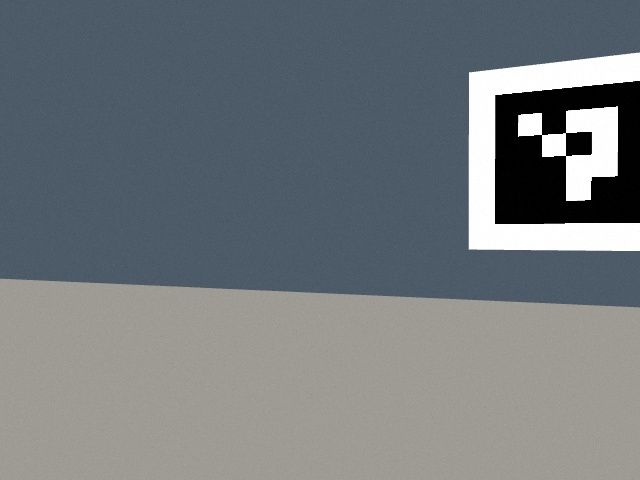
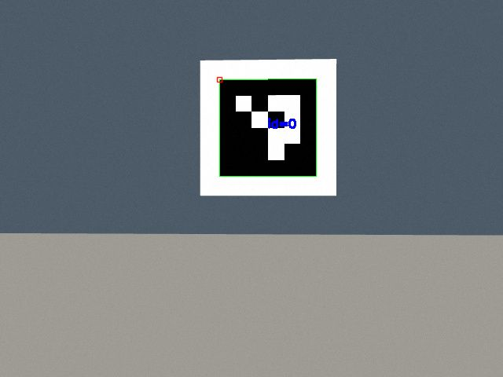

# 2026-10-29 가상환경 합부 판정

실차 주행은 다른 팀원이 담당하므로 이 시험은 **로컬 Gazebo만** 사용했습니다.
시험 도메인은 185, Gazebo 포트 11585, 임시 웹 포트 18890입니다.
시뮬레이션은 기존 `simulation_room.world`와 저장 지도에서 시작점 `(-3, -2)`를 사용했습니다.

## 판정 기준

- 주행: 경로 수신, 0이 아닌 최종 속도 명령, 실제 시뮬레이션 odom 변위 0.3m 이상,
  Nav2 성공 응답, 최종 지도 TF 기준 목표 거리 0.35m 이내를 모두 만족.
- 조종기: 실제 PyQt 지도 패널의 목표 전송, 실시간 지도·차량 자세·경로 표시를 확인.
- 영상: 주행 중 웹 JPEG 응답이 새로 갱신되고, 위치·지도·센서 준비 상태를 유지.
- 장애 주입: 시뮬레이터 물리/센서/시계를 일시 정지했을 때 최종 속도 0,
  이상 지속 시 정지 잠금, 시뮬레이터 재개 후 자동 재출발 금지.
  개선 목표는 정지 명령 1초 이내입니다. 제동 거리/물리적 정지는 별도 항목입니다.

## 주행 결과

| 시험 | 판정 | 시간 | 최종 목표 거리 |
|---|---|---:|---:|
| baseline 직진 `(-1, -2)` | 합격 | 10.108초 | 0.222m |
| 독립 EKF 우회 `(3, 2)` | 합격 | 74.393초 | 0.180m |
| 독립 EKF 홈 복귀 `(-3, -2)` | 합격 | 69.352초 | 0.082m |
| baseline + 압축 영상 + PyQt 목표/지도 | 합격 | 76.945초 | 0.163m |
| 독립 EKF + 압축 영상 + 최종 loopback 통신 + PyQt 목표/지도 | 합격 | 56.148초 | 0.162m |

마지막 두 시험은 웹에서 주행 중 6회씩 조회한 영상 해시가 모두 달랐습니다.
PyQt의 지도·목표·경로 기능과 웹 영상 수신을 동시에 시험했으며,
PyQt 카메라 위젯 자체에 영상을 연결해 시험한 것은 아닙니다.
최종 주행에서 위치 품질 CRITICAL과 잘못된 자동 명령 순서는 관측되지 않았습니다.
출발 준비 중의 WARNING은 별도로 기록했습니다.

물리/센서/시계 정지 시험의 최종 수치, 소프트웨어 테스트 수, 기록기 측정값은
아래 JSON에 함께 보관합니다.

- [시험 결과 원본 JSON](results.json)
- [조종기 지도·목표 도착 화면](controller_goal.png)

최종 센서·시계 정지 시험은 정지 명령까지 **0.333초**, 정지 잠금까지 **1.085초**로
측정됐고, 재개 후 167개 출력 샘플이 계속 0이었습니다. 기존 1초 센서 제한 설정의
정지 명령 약 1.25초는 엄격한 1초 기준에 불합격했으며, 이 이전 결과도 삭제하지 않았습니다.
전체 ROS 테스트 **800개**, 조종기 테스트 **59개**, JS UI 검사 **5개**가 통과했습니다.

## 실제 영상으로 ArUco 도착 확인

`simulation_maze_aruco.world`의 실제 ID0 보드를 사용했습니다. 초기 차체·관측 목표의
yaw를 의도적으로 +0.4rad 틀어 보드 일부가 화면 밖에 있는 상태로 출발했습니다.
6초 정지 대기로 AMCL 마지막 수신 나이가 8.97초인 상태도 함께 재현했습니다.

| 확인 항목 | 결과 |
|---|---|
| 해당 Nav2 목표 완료 후 탐색 시작 | 합격 |
| SEARCHING → CENTERING → SETTLING → CONFIRMED | 합격, 약 21.8초 |
| 실제 영상의 목표 ID·가로 중앙·정지·안정 프레임 | 합격, 정규화 중심 오차 0.064 / 안정 5프레임 |
| 정렬 중 선속도 명령 0 / 회전 명령 ≤0.15rad/s | 합격 |
| 확인 완료 기록 및 기존 자동 홈 복귀 정책 | `[0]` 완료 후 `HOME_REACHED` |




합성 ID나 생성 영상을 검출기로 넣지 않았습니다. 시뮬레이션의 단일 전방 카메라 영상을
기존 `rear` 역할에 연결한 시험이며, 실차의 전·후방 장치 장착 오차 시험과는 구분합니다.
실제 EKF odom 추정 각속도는 탐색 반전 순간 **0.257rad/s**까지 관측됐습니다.
0.15rad/s는 명령 제한이므로 차체의 실제 각속도까지 이 값 이하였다고 해석하지 않습니다.

[ArUco 검사 결과](aruco_alignment.json)에 원래 검증기가 `COMPLETED`만 예상했던
판정 오류와, 실제 웹의 자동 복귀 정책에 맞춘 `HOME_REACHED` 최종 판정을 함께 남겼습니다.
수정 전 오래된 AMCL 정지 시간 때문에 회전이 중단됐던 실패 로그도 보존했습니다.

## 다시 시험하기

평소의 시뮬레이션 도메인 76에서 실행하는 예입니다. 실차 터미널에서 실행하지 않습니다.
ROS Humble 의존성이 없다면 저장소 README의 설치부터 완료하세요.

```bash
# 터미널 1: 가상환경만 실행
cd ~/Team2_workspace/src/SMART-VISION-AMR
./scripts/run_sim.sh gui:=false use_rviz:=false localization_mode:=ekf_independent
```

```bash
# 터미널 2: 실제 조종기 지도 패널로 목표를 보내고 판정
cd ~/Team2_workspace/src/SMART-VISION-AMR
source scripts/sim_env.bash
python3 scripts/verify_sim.py --via-controller \
  --goal-x 3.0 --goal-y 2.0 --goal-yaw 1.57 --timeout 150
```

`verify_sim.py`는 전용 시뮬레이션 도메인·localhost·Gazebo 주소가 맞아야
목표를 발행합니다. 준비 실패나 목표 발행 전 오류로 다른 임무를 취소하지 않습니다.
반복 비교용 CSV와 설정 해시는 [벤치마크 도구](../../docs/NAVIGATION_BENCHMARK.md)를 사용합니다.

## 판정 한계

- 목표 거리는 지도 TF 추정치입니다. Gazebo 정답 궤적이나 실차의 절대 위치 오차가 아닙니다.
- 충돌 contact 센서·최소 벽 거리 시험을 하지 않았으므로 무충돌을 증명한 결과는 아닙니다.
- 라이다가 기존 벽을 갱신하면서 재계획한 것은 확인했습니다. 의도적으로 움직이는 장애물을
  삽입한 시험과 카메라 사각지대의 저상 장애물 시험은 **미검증**입니다.
- 조건별 단발 시험이라 baseline과 EKF의 성능 우열을 결정할 수 없습니다.
- 이 결과로 실차 통신 안정성·제동 거리·배터리·센서 보정 성능까지 합격 처리하지 않습니다.
- 전체 경로 시험은 센서 제한 1초 설정에서 수행했습니다. 이후 정지 응답 개선을 위해
  0.5초로 변경하고 별도 장애 주입 시험으로 재검증했습니다. 두 설정 결과를 JSON에서 구분합니다.

이전 코드 기준점은 Git 커밋 `c21ca7a`입니다. 이번 시험용 임시 프로세스만 종료하며,
팀원의 실차 실행과 운용 웹 서비스는 재시작하지 않습니다.
