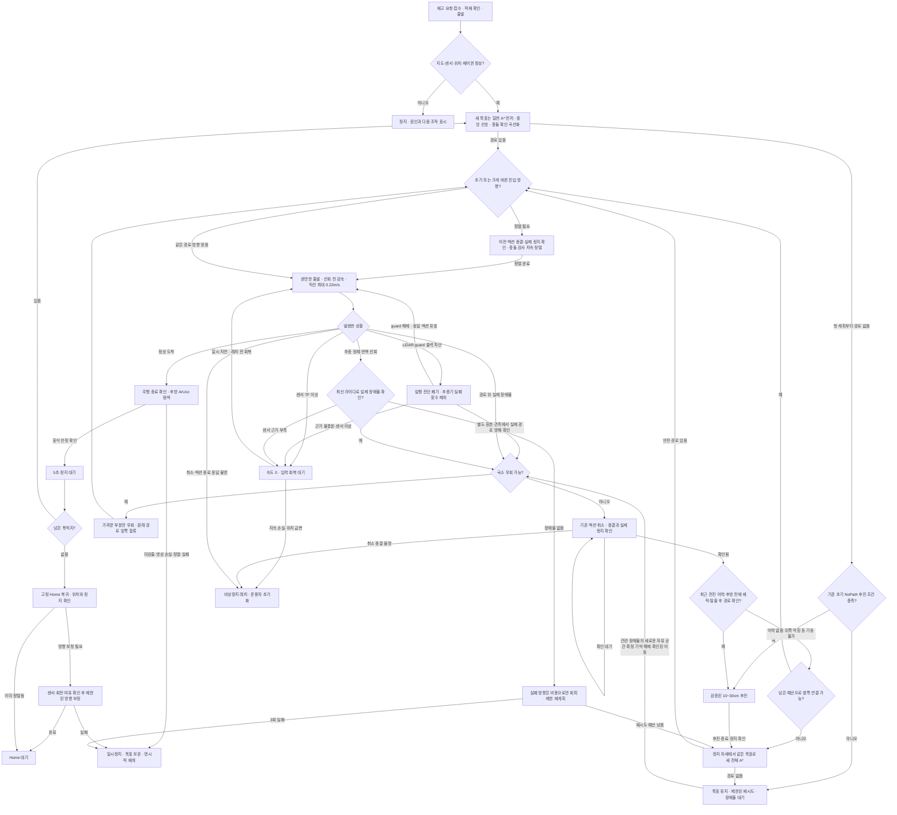

# 주행 문제 해결 트리

현재 교실 실행 스크립트에 연결된 분기입니다. 목표를 유지한 상태에서 복구하되,
센서 손실·제어권 불명·운용자 정지를 장애물로 기록하거나 자동으로 해제하지 않습니다.
실차 실행 순서는 [팀원 퀵스타트](TEAM_QUICKSTART.md)를 따릅니다.

물리 장애물과 실행 실패는 분리합니다. 지도·실시간 장애물·확정 장애물 기억은
통행 금지 셀을 만들지만, `controller_aborted`·진행 정체·진동 같은 실행 실패는
방향별 추가 비용만 만듭니다. 같은 접근을 덜 선호하되, 실패 기록만으로 경로 존재성이
사라지지 않게 합니다. 실제 입력·충돌 검사와 목표별 추종 재시도 3회 제한은 유지합니다.

현재 설정은 **차체 반경 22cm / A* 정적 지도 5셀(5cm 지도에서 25cm)**입니다.
과거 20cm 모사 시험과 현재 설정의 검증 결과는 구분합니다. 22/30/40cm 비용 팽창
비교에서는 각 임무가 Home으로 돌아왔지만, 이동 장애물 시험 조건까지 모두 통과한
것은 아닙니다. 이 비교는 당시 정책의 기록입니다. **이 문서의 구현 설명만으로 최신 전체
폐루프 시험 합격이나 실차 재시험 완료를 뜻하지 않습니다.** 후보별 입력·코드 버전과
판정은 [파라미터 비교 기록](../benchmarks/driving_parameter_tuning_20261104/README.md)에
따로 기록합니다.

## 주행과 복구 순서

모든 분기에서 **비상정지 → 운용자 조종/일시정지 → 임무 주행** 순서로 우선합니다.
조이스틱 해제는 수동 제어가 끝났다는 뜻이며, 오래된 속도 명령을 재생하지 않습니다.
임무가 보존되고 제어권 인계·정지가 확인된 경우에만 같은 목표로 다시 계획합니다.
운용자가 누른 일시정지·비상정지와 `CONTROLLER_HOLD`는 명시적 재개가 필요합니다.

**처음 목표를 받은 경우와 이미 주행한 경로가 막힌 경우를 구분합니다.** 처음에는
일반 A*를 먼저 실행하며, 경로가 없으면 기존 초기 NoPath 후진 검사를 사용합니다.
주행 중 확인된 장애물로 활성 경로가 막히면 **국소 우회 → 취소 종결·정지 확인 →
검증된 후진 → 같은 목표의 새 전체 계획** 순서입니다. 후진 이력·후방 공간·탈출 후
경로가 부족하면 무리하게 후진하지 않습니다. 같은 국소 탐색 예산의 남은 부분으로
옆쪽 연결 경로를 검토한 뒤, 있으면 정지·필요한 선회를 거쳐 진입하고 없으면
정지를 유지한 채 전체 계획으로 넘어갑니다. 선회만 하고 갈 방향을 나중에 고르지 않습니다.
센서·제어권·정지 증거가 아직 준비되지 않은 것은 후진 불가 확정과 다릅니다. 이때는
확인 대기 상태를 유지하며 다음 전진 액션을 먼저 보내지 않습니다.

### 기존 복구 정책을 교체하는 기준

복구는 동일 목표·지도에 속한 하나의 episode가 소유합니다. 여러 callback과 재시도
타이머가 각자 전체 계획·후진·실패 대기를 선택하지 않습니다.

| 단계 | 진입·종료 기준 |
|---|---|
| 국소 우회 | 현재 경로 앞부분을 고치고 기존 경로 앞쪽에 합류. 실패하면 정지 확인 단계 |
| 정지 확인 | 기존 액션 취소 종결·실제 정지·신선한 입력 확인. 단순히 시간이 지났다는 이유로 통과하지 않음 |
| 후진 검토·실행 | 최근 전진 이력과 후방 전체 궤적을 검증. 뒤가 막히면 후진 금지. 남은 국소 예산의 옆쪽 경로와 기존 선회 인계를 검토 |
| 전체 재계획 | 후진 뒤 현재 자세 또는 후진 불가가 확인된 현재 자세에서 같은 목표를 한 번 계획 |
| 장애물 대기 | 전체 경로도 없으면 목표 유지. 같은 입력의 주기적 재계획 대신 실제 자유 공간·유효한 환경 변화·명시적 재개를 기다림 |

기존 실패 횟수가 쌓였다는 이유로 국소 우회·후진을 시도하기 전에 막지 않습니다.
전체 계획 실패 뒤 후진을 다시 검사하는 두 번째 분기도 사용하지 않습니다.
현재 복구가 진행 중일 때 이전 전진 액션의 늦은 성공이나 이전 후진의 종료 응답이
현재 episode를 완료·초기화하지 못하도록 소유권을 확인해야 합니다.
이 절의 새 정책은 변경 후 회귀·폐루프 결과로 판정하며, 이전 정책의 시험 결과를 그대로 승계하지 않습니다.

PC의 `smart_vision_amr_dwb::RouteTrackingDWB`는 DWB가 보는 국소 경로 끝을 현재
경로를 따라 **0.55m 앞**으로 제한합니다. U자 경로에서 벽 건너 최종 목적지나
되돌아오는 다른 가지를 당장 향하는 문제를 줄이며, 전체 경로와 실제 목표는 유지합니다.
선회 시 0.10~0.15m/s 제한을 **DWB 후보 궤적 평가 전에** 적용해, 다른 곡률로
평가한 명령을 출력 단계에서만 갑자기 바꾸는 차이도 줄입니다. 원본 라이다를 이용한
Nav2 충돌 검사는 유지합니다. 이동 DWB 후보의 회전 상한은 **0.35rad/s**,
순수 제자리 DWB 후보는 **0.50rad/s**입니다. Nav2 Spin의 별도 상한 0.35rad/s와 구분합니다.
내부 도착 판정과 최종 회전 진입은 모두 15cm로 맞추고, 독립 Gazebo 실제 위치
검사의 25cm 기준은 유지해 추정 오차에 대한 여유를 둡니다.

출발 가속은 최종 `/cmd_vel` 발행에서도 제한합니다. 기본 20Hz 발행에서
선속도는 0.15m/s²로 증가해 정지→0.22m/s에 약 1.47초가 걸리고, 후진 0.10m/s에는
약 0.67초가 걸립니다. 각속도 증가는 0.80rad/s²이며 전후진 또는 선회 방향을
반대로 바꿀 때 먼저 속도 0을 발행합니다. 다만 전진 중 0.08rad/s 미만의 작은
헤딩 보정은 부호가 바뀔 때마다 차량 전체를 멈추지 않고 각속도만 0.80rad/s²로
연속 변경합니다. 실제 선회에서는 선속도·각속도를 같은 비율로 줄여 평가한 경로의
곡률을 보존합니다. 정지·비상정지·센서 차단은 가속 제한을 거치지 않고
즉시 0을 발행합니다. 100~200ms 지연을 매번 재출발로 처리하지 않으며, 한 번의
발행에서 사용하는 가속 시간은 최대 0.10초로 제한합니다. 0.50초를 넘는 발행 공백이나
제어 주체 변경 후에는 다시 0부터 시작합니다. 상태 조회는 가속을 진행시키지 않고
실제로 발행한 속도를 표시합니다.

## 재시도와 복귀 조건

| 분기 | 현재 기준 | 다음 단계 |
| --- | --- | --- |
| 출발·재출발 | 최종 속도 발행에서 선가속 0.15m/s², 각가속 0.80rad/s² 제한. 0→0.22m/s 약 1.47초 | 전후진·큰 회전 방향 반전은 0속도 경유. 작은 전진 헤딩 보정은 선속도를 끊지 않음 |
| 선회 전 감속 | 경로 앞 1m를 보고 곡률·남은 거리·감속도 0.10m/s²로 속도 상한 계산. 커브 15cm 전에 낮은 상한에 도달 | 선회 0.10~0.15m/s 상한. 장애물 정지·비상정지에는 완만한 감속을 적용하지 않음 |
| 가까운 실제 장애물 | 원본 `/scan`은 매번 Nav2·로봇 정지 검사에 전달. 차체 중심에서 `robot_radius + 0.18m` 이내의 경로 방해는 먼 장애물 확인 대기 없이 반응 | 국소 우회 → 취소·정지 확인 → 검증 후진 → 같은 목표 전체 계획 |
| 먼 경로 방해 셀 | 새 라이다 관측 3회·최소 0.15초 일관성 확인. 과거 관측을 TTL로 반복 발행하는 것은 새 스캔으로 세지 않음 | 경로와 겹칠 때만 우회/재계획 |
| 국소 우회 | 전체 재계획보다 먼저 검색. 60ms·1,500 확장·합류 후보 10개·검증된 재합류 전 최대 3회. 우회 길이 4m·옆 이동 0.9m 제한 | 진행 중 우회가 새 실제 장애물에 막혀도 남은 예산에서 국소 복구 우선. 실패하면 먼저 취소·정지를 확인하고 후진 검사 |
| 미관측 깊이 가정 때문에만 경로 없음 | 보수적인 가상 연장 20cm 탐색이 실패하면 가상 영역만 비용으로 바꿔 재탐색. 실측 장애물·기억·정적/unknown·차체 팽창은 계속 금지 | 국소 탐색 예산을 공유. 전체 fallback도 최신 입력·자율 제어권과 정상 출발점 또는 같은 호출에서 검증한 제한된 첫 간선 인증 필요. 탐색 예산 소진을 실제 통로 폐쇄로 단정하지 않음 |
| 우회 경로 전달 | 활성 경로의 같은 나머지 구간인지는 **3cm 이내·연속·순서 보존**으로 확인. 18.5cm 옆으로 바뀐 우회를 예전 20cm 중복 허용치로 버리지 않음 | 단순 앞부분 제거·재샘플링은 기존 액션 유지. 다른 경로는 이전 액션 종결 후 전달 |
| 초기 목표 전체 A* | 새 명시적 목표는 지도·실시간 장애물·확정 기억·실패 접근 비용으로 먼저 계획. 재시도 주기 기본 2초 | 처음부터 경로가 없으면 기존 검증 후진 조건 검사. 목표는 유지 |
| 활성 경로 복구 후 전체 A* | 국소 우회 실패 시 후진 검사보다 먼저 새 전진 경로를 보내지 않음. 후진이 끝났거나 기동 불가가 확인된 정지 자세에서 새 계획 | 후진 전 계획을 그대로 재사용하지 않고 최신 지도·관측·현재 자세로 같은 목표를 탐색 |
| 후진 | 실제 odom 이력·현재 자세와 원본 지도·후방 라이다·전체 후진 궤적·끝점부터 목표까지 경로 확인. 0.10~0.30m, 0.10m/s | 활성 장애물 복구 주기에서 한 번 검토·실행 후 같은 목표 A*. 첫 NoPath 후진은 별도 목표당 3회 제한이며 과거 횟수가 새 장애물 복구를 선점하지 않음 |
| 후진 불가 / 증거 대기 | 후방 막힘·이력 없음·탈출 후 경로 없음 등은 각각 `reverse_unavailable_reason`으로 기록. 센서 지연·정지 미확인은 기동 불가 확정으로 건너뛰지 않음 | 기동 불가는 정지 유지 후 전체 계획. 센서·제어권·정지 증거 미확인은 복구 큐에서 기다림 |
| 실제 장애물 대기 | 같은 복구 주기의 국소 우회·후진 검토·전체 계획이 끝나도 경로가 없으면 목표를 유지하고 대기. 과거 실패 횟수가 새 복구 단계를 선점하지 않음 | `WAIT_OBSTACLE`. 동일 입력의 주기적 전체 재계획 없음 |
| 장애물 대기 해제 | 신선한 자유 공간 확인·경로를 막은 확정 기억의 실제 해제·확인된 장애물 이동을 소비해 새 복구 주기 시작. 단순 TTL 만료·같은 증거 재수신 제외 | 제어권·위치가 정상인 동일 임무만 국소 우회부터 자동 재개 |
| 추종기 실패 | 주행 실패를 확인했지만 실제 장애물 근거가 없고 입력이 정상이면 실패 방향을 약한 비용으로만 사용. 재시도 횟수는 공간 기억의 TTL과 독립 | 제한 재계획 후 `controller_retry_limit=3`이면 `CONTROLLER_HOLD`. 웹은 임무를 일시정지하고 명시적 재개 안내 |
| LiDAR guard 정지 | `scan_guard_hold=true`이면 실행 관측·이전 명령 의도·미확정 실패 진단을 폐기. guard에 의한 `ABORTED`는 `WAIT_REPLAN`, `route_failure=false` | **추종기 실패 3회 예산에서 제외**. 실제 장애물은 별도의 최신 raw/관측/기억과 시도 구간 교차로 확인하며, guard만으로 장애물을 만들지 않음 |
| 실패 원인 판별 | 지도와 다른 raw 반사가 있어도 실제 시도 구간의 **설정된 차체 범위(현재 22cm)**와 교차해야 장애물 근거로 사용. 측면 벽 오차만으로 앞 통로 전체를 금지하지 않음 | 일시적인 raw 반사 분류로 재시도 이벤트를 삭제하지 않으며, 실제 장애물 episode로 등록한 경우만 장애물 예산으로 이전 |
| 출발·큰 우회 변경 방향 정렬 | 최초 정렬 최대 2회. 같은 목표라도 근거리 경로가 실제로 달라지고 15cm lookahead 방향 오차가 0.55rad를 넘으면 이전 액션 종결·실제 정지 후 별도 정렬 | 동등 나머지 경로·재발행은 추가 선회 없음. 우회 정렬은 경로당 2회·목표당 6회 한도, 반복 초과 시 `CONTROLLER_HOLD` |
| 액션 인계 | FollowPath 접수 5초·피드백 5초 감시. 취소 0.5초 간격 재요청. 취소 시작 후 3초 안에 종료를 확인하지 못하면 비상정지 요청 | 취소 승인만으로 후진/새 경로를 시작하지 않음. 종결 결과와 정지 확인 필요 |
| 표식 확인 | 후방 목표 ID를 도착 이후 새 영상에서 확인. `recognized` 모드는 가로 중앙 ±15% 폭을 허용하며 완벽한 중앙을 요구하지 않음 | 연속 검출·정지 확인 후 5초 대기. 과도한 보정은 제한하고 실패 시 목표 보존·일시정지 |
| Home 최종 확인 | Home FollowPath 성공 이후 실제 위치·정지·방향 확인. 작은 잔여 yaw만 최대 0.15rad/s, 8초·0.70rad 이내 보정 | 완료 시 `HOME_REACHED`. 센서/여유/정렬 실패는 `PAUSED`, 완료로 처리하지 않음 |

국소 우회 예산은 관측 갱신·전체 재계획·액션 실패만으로 환불하지 않습니다. 원래 경로의
합류 지점을 실제로 지나갔고 최신 지도 자세와 독립 odometry의 이동이 일치해야 다시
3회를 사용할 수 있습니다. 목표·지도·원래 경로의 상관 확인과 수동 정지는 계속 적용합니다.
액션 실패 이후의 국소 복구는 **종결 결과가 확인되고, 실제 시도 구간의 차체 범위를
장애물이 막았다는 독립 근거가 있을 때만** 우선합니다. 센서 이상이나 장애물 없는
추종기 정체를 국소 장애물 복구로 분류하지 않습니다.

최근 전진 이력은 임의로 만들어 보충하지 않습니다. 후진 후보는 이력과 실제 명령 축
양쪽의 전체 차체 면적, 현재 위치와 이력의 일치, 후방 라이다, 팽창 밖 종료점과 같은
목표까지의 경로를 모두 통과해야 합니다. 미관측 깊이를 가정한 가상 연장만으로 탈출 후
경로가 막혔다면 일반 A*와 같이 가상 영역만 비용으로 바꾸어 다시 검사할 수 있습니다.
실측 장애물·확정 기억·정적/unknown 셀은 계속 통행 금지입니다. 실행 실패 방향은 장애물 점유와 구분한 비용으로 사용합니다.
`reverse_clearance_neutral_egress_enabled`는 별도 선택 기능입니다. 활성화하더라도
실제 앞쪽 방해물이 없는, 물리적으로 비어 있는 팽창 내부 출발에만 거리 증가 선호를
면제하며 전체 차체 궤적·이력·종료점·목표 경로 검사를 생략하지 않습니다.

### 센서 지연은 단계별로 처리

- 로봇 위치 감시가 `/scan`·`/odom`을 0.7초 넘게 받지 못하면 자율 속도를 막습니다.
- 경로 추종 중 1초 이내의 일시 지연은 경로 취소 전에 회복 기회를 줍니다. 새 FollowPath는 scan/odom 0.75초 미만이 필요합니다.
- 지연이 계속되면 FollowPath를 취소하고 새 입력·정지 확인 이후 같은 목표를 재계획합니다. 센서 오류를 장애물 기억으로 저장하지 않습니다.
- 지속 센서/위치 이상이 정지 래치를 발생시키면, 수신이 돌아왔다는 이유만으로 출발하지 않습니다. 원인 확인·위치 초기화가 필요한 경우 이를 완료하고 비상정지 해제 후 명시적으로 시작합니다.
- EKF의 `Failed to meet update rate` 한 줄과 실제 센서 손실은 구분합니다. 수신/원본 시각·TF·실제 구동 명령을 함께 봅니다.

### LiDAR guard의 기하·시각 보정

- 실제 **laser→base 장착 TF**로 원본 반사점을 변환하고, 현재 원형 차체와 **요청 속도로 0.5초간 움직일 궤적**의 교차를 검사합니다. 라이다 원점의 거리만으로 평행한 측면 벽을 전방 장애물로 취급하지 않습니다.
- 스캔 획득 시각의 **odom→base 자세**를 저장합니다. 매 속도 출력 때 최신 odom 자세로 반사점을 다시 투영해 스캔 이후 차량이 이동한 양을 반영합니다.
- 스캔 원본 시각·수신 경과는 **1초 미만**, 최신 odom 자세 시각은 **250ms 미만**이어야 합니다. 최신 자세 이후 남은 지연에는 최대 선속도·각속도로 계산한 **진행 방향·횡방향·각도별 이동 상한**을 적용하며, 전체 스캔 지연을 원형 차체 반경에 일괄 추가하지 않습니다.
- 새 스캔 시각이 최신 TF보다 조금 앞서면 보간 가능한 TF가 올 때까지 `pending`으로 둡니다. 이전에 검증한 스캔이 유효하면 이를 계속 최신 자세로 보정해 사용합니다. 이전 유효 스캔도 없으면 정지를 유지합니다.
- 새 raw 반사가 현재 차체 또는 요청 궤적과 즉시 교차하면 **첫 스캔부터 정지**합니다. TF 대기나 반복 관측 확인을 이유로 임박한 교차를 무시하지 않습니다.
- 장착 TF·odom 자세가 없거나 잘못됐을 때, 스캔 수치가 유효하지 않을 때, 시각이 만료됐을 때는 `hold`를 유지합니다. 원인과 `scan_guard_code`, 보정 시각·간격은 상태에 기록합니다.

추가로 요청 속도와 **최신 odom의 측정 속도**를 나누어 제동 궤적을 검사합니다.
감속 명령을 냈다는 이유로 실제 차가 이미 멈췄다고 가정하지 않습니다. 바퀴별 속도와
감속 가정으로 정지 궤적을 확인하고, 진행 여유가 줄면 선속도·각속도를 같은 비율로
미리 낮춥니다. 명령이 0이어도 측정 잔류 속도의 궤적 검사는 계속합니다.
설정은 [motion_mux_hardware.yaml](../ros2_ws/src/smart_vision_amr/config/motion_mux_hardware.yaml)에
있으며, 바퀴 감속도 0.15m/s²는 느린 Gazebo 구동 응답을 위한 보수적 가정입니다.
실차의 측정된 제동 성능이 아니므로 연결 후 별도 확인해야 합니다. 진행 방향 정지
여유 2cm를 평행한 측벽의 차체 반경에 더하지 않습니다.

DWB에는 가까운 경로 30cm의 연속 횡오차와 방향 오차를 비용으로 추가합니다.
뒤쪽 코너의 목표만 먼저 향해 현재 직선에서 벽 쪽으로 잘라 들어가는 선택을 줄이며,
기존 충돌 거부·실제 목적지·최종 yaw 도착 조건은 유지합니다.

실제 `tf2.Buffer`를 사용한 **20Hz TF / 10Hz scan / scan이 10ms 앞서는 입력**에서
불필요한 0속도 펄스 없이 보정하는 회귀를 통과했습니다. **200ms 지연 중 전방 접근은
정지하고 평행 벽은 통과**하는 회귀도 통과했습니다. 이 입력 시험과 현재 22cm 모델의
전체 폐루프·장애물 합격 판정은 별개입니다. 최신 복구 순서 변경 후에는 전체 웹 운용
절차와 장애물 시험을 다시 실행하고, 실차 재시험 결과도 별도로 남겨야 합니다.

## 충돌 크기와 기억의 구분

실차 반경은 A*·후진 복구·Nav2·웹의 회전 검사까지 **22cm**입니다.
웹의 자세 초기화·표식 탐색·Home 방향 보정은 같은 원본 라이다 회전 검사 결과를 사용합니다.
과거 웹 회전 검사의 숨은 30cm 기본값은 실차 실행에서 22cm로 명시했습니다.
Generic 웹 직접 실행의 기본값 30cm는 유지하고, Gazebo 교실 웹은 모델 반경 24cm를 전달합니다.
`--physical-footprint`로 실차 반경 22cm를 모사하는 경우에만 웹도
`SMART_VISION_CLASSROOM_SIM_ROTATION_RADIUS=0.22`으로 맞춥니다. 이 모드는
실제 Gazebo 충돌 모델과 주행 설정까지 22cm로 변환하며 기본 24cm 모델은 보존합니다.

수동 초기 위치 지정도 같은 반경을 사용합니다. 점유·미확인 셀의 **사각형 전체와
차체 원의 실제 거리**를 검사하므로, 격자 반대각선을 다시 더해 차체를 키우지 않습니다.
출발 가속 제한은 100~200ms의 실행 지터 때문에 매번 0으로 돌아가지 않으며,
지연된 시간을 한 번에 큰 가속 여유로 쓰지도 않습니다. 센서·명령 임대가 만료되면
기존 정지 절차가 우선합니다.

A* 정적 지도 5셀 팽창은 5cm 지도에서 장애물 셀과 첫 통행 셀의 전체 면적 사이 최소 25cm를
확보하는 사각 팽창입니다. 축 방향 최소 여유는 25cm이고 대각 모서리는 더 보수적이므로,
원형 차체 22cm와 단순히 3cm만 차이 나는 동일 형태는 아닙니다.
현재 관측과 확정 기억은 같은 22cm 원형 차체와 셀 전체 면적을 사용합니다.
기억으로 확정됐다는 이유만으로 사각 5셀 팽창으로 바꾸지 않습니다.
차체 반경에 25cm를 다시 더하지 않습니다. 현재 운영 YAML의 Nav2 비용 팽창은 총
22cm입니다. 다른 비용 팽창·중앙 선호·추종 설정의 비교는 차체 크기를 고정하고
같은 코드·장면에서 한 변수씩 진행하며, 후보 시험 결과를 운영 설정 합격과 혼동하지 않습니다.
**45cm 중앙 선호는 추가 차단 영역이 아니며** 통과 가능한 좁은 길을 닫지 않습니다.

DWB는 `BaseObstacle`과 `ObstacleFootprint`로 차체 외곽까지 검사합니다.
`ObstacleFootprint.scale=0.02`, 추가 footprint padding은 0입니다. 0.02는 충돌 없는
후보의 선호 비용이며, 충돌 후보를 허용하는 비율이 아닙니다. 반경 22cm 원형 모델은
직경 44cm이므로 실제 폭 30cm 통로의 통과를 보장하지 않습니다.

| 레이어 | 보관 목적 | 제거 조건 |
| --- | --- | --- |
| 저장 SLAM 지도 | 벽·고정 구조 | 이 기능에서 원본 지도 파일을 수정하지 않음 |
| 실시간 장애물 | 새 스캔에서 보인 객체를 즉시 우회에 사용 | 관측 갱신·TTL. 표시가 사라졌다는 사실만으로 장애물 대기 해제를 승인하지 않음 |
| 장애물 기억 | 스캔 범위를 벗어나도 다음 섹터 계획에 반영 | 셀별 5회·최소 2초 관측으로 확정, 이후 실제 자유 광선 5회·최소 2초 확인으로 삭제 |
| 실패 접근 기억 | 같은 위치·진입 방향에서 반복 실패 최소화 | 지도/목표 범위 분리·120초 TTL. 센서 손실·수동 취소는 장애물로 만들지 않음 |

## 핵심 상황별 판정

`NoPath`는 현재 지도·측정 표현과 계산 예산에서 경로를 확인하지 못했다는 뜻입니다.
실제 통로가 물리적으로 없다는 증명과 구분합니다. 5cm 장애물 셀·격자로 생긴 좁은 구간
정체와 미채택 1cm 검색의 시간 제한은 [실차 조건 재현 결과](GAZEBO_PHYSICAL_TRANSFER.md)에
남겼습니다. 차체 크기나 raw 충돌 검사를 임의로 줄여 해제하지 않습니다.

| 시험 상황 | 기대 동작 | 자동 재개 / 운용자 |
| --- | --- | --- |
| Home에서 첫 출발 / 다음 배송 재출발 | 등록 위치를 실제로 확인 후 AMCL 입력. 첫 방향 정렬은 목표 첫 출발에만 수행 | 비상정지 해제와 출발은 운용자 |
| 추종 중 경로가 조금 바뀜 | 같은 목표의 재계획마다 제자리 선회를 반복하지 않음 | 최신 안전 경로로 인계 |
| 새 우회 방향이 크게 달라짐 | 최초 정렬 완료 여부와 별개로 취소 종결·실제 정지·회전 공간을 확인하고 새 진입 방향에 정렬 | 해당 Spin 종결과 최신 경로·입력 확인 뒤 추종; 이전 응답으로 새 목표 출발 금지 |
| 벽 가까이로 지름길 선택 | 중앙 선호 비용을 A*와 곡선화 모두 보존 | 좁은 유일 통로는 허용 |
| 바깥쪽 코너 일부만 곡선화 불가 | 그 코너만 원래 형태를 보존. 안전한 나머지 곡선과 단축은 유지 | 전체 경로를 불필요하게 각진 격자로 되돌리지 않음 |
| 우회 가능한 갑작스러운 상자 | 빨간 실시간 장애물 표시 → 국소 우회 → 원경로 앞쪽 합류 | 입력·충돌 여유 정상 시 자동 |
| 국소 우회가 안 되는 활성 경로 | 기존 액션 취소·종결·정지 확인 → 최근 이력으로 검증 후진 → 같은 목표의 새 전체 계획 | 후진 증거 미준비 중 전진 액션을 보내지 않음 |
| 통로 전체를 막는 상자 / 지나가는 다른 로봇 | 후진 가능성 검사 → 기동 가능하면 후진 후 전체 계획, 불가하면 정지 자세에서 전체 계획 → 목표 유지 대기 | 실제 제거/다른 안전 경로 확인 시 자동 |
| 처음 받은 목표부터 경로 없음 | 일반 A*를 먼저 실행한 뒤 기존 초기 NoPath 후진 검사 | 활성 경로용 복구 큐 때문에 첫 목표부터 무조건 후진하지 않음 |
| 장애물 표시 TTL 만료 / 센서 사각으로 이동 | 빈 공간 증거로 오인하지 않음. 확정 기억 유지 | 실제 자유 광선 전에는 대기 해제하지 않음 |
| 실제 장애물 없이 DWB 정체·좌우 진동 | 장애물 생성·통로 봉쇄와 구분. 약한 실패 비용으로 제한 재계획 | 반복 실패 시 운용자가 자세·경로 확인 후 재개 |
| DWB는 진행 명령을 냈지만 LiDAR guard가 출력 0으로 변경 | 이전 실행 의도와 진단을 폐기. guard 유래 ABORT를 추종기 실패로 누적하지 않음 | 센서/기하 근거 회복 또는 별도 확인된 실제 장애물 복구. 취소 종결 전 새 액션 금지 |
| 센서·TF 짧은 지연 | 속도 0, 일정 시간 같은 액션/목표 보존 | 래치 전 정상 입력 회복 시 자동 |
| 센서 장시간 손실 / 위치 급변 | 정지·취소·필요 시 비상정지 래치 | 운용자 확인·필요한 위치 초기화 후 재개 |
| 취소 응답·종결 결과 지연 / 옛 액션 결과 뒤늦게 도착 | 새 경로/후진과 중복 실행 금지. 목표·경로 stamp 상관 확인 | 취소 불명은 정지 래치, 운용자 확인 |
| 조이스틱 개입·해제 | 조종기 우선, 임무는 보존. 오래된 자율 명령은 폐기 | 명시적 정지 명령이 없으면 정상 인계 뒤 같은 목표 |
| 브라우저만 종료 | PC 웹 서버·주행 노드가 유지되면 서버의 임무는 계속 존재 | 브라우저 재접속 가능 |
| PC↔로봇 Wi-Fi 단절 / PC 종료 | 로봇에 최신 주행 명령·상태가 오지 않으면 임대 만료·속도 0 | 통신·위치 복구 확인. 끊긴 동안 맹목 주행하지 않음 |
| 저전압 / OpenCR·모터 드라이버 통신 오류 | 로봇 센서 감시기가 비상정지를 유지. 실차 실행 기준 전압 10.8V, 저전압 발생 후 재무장은 0.2V 복구 여유를 확인 | 배터리·구동기 연결 점검과 센서 안정 확인 후 운용자가 해제. 구동기 오류를 경로 우회로 해결하려 하지 않음 |
| 마커를 못 찾음 / 영상 손실 / 회전 공간 부족 | 제한 탐색 또는 정지. 배송 완료로 넘기지 않음 | 표식·카메라·차량 자세 확인 후 재개 |
| Home 근처지만 방향 오차·차량 움직임 남음 | `HOME_REACHED`를 먼저 만들지 않음 | 최종 보정·정지 검증 실패 시 재개 필요 |
| 정지 중 로봇을 들어서 다른 곳에 배치 | 기존 odom/지도 위치를 실제 위치로 신뢰하지 않음 | 새 실제 위치로 AMCL 초기화 후 출발 |

## 구현 위치와 검사

| 책임 | 코드 / 핵심 함수 |
| --- | --- |
| 단일 속도 출력·제어 우선순위·통신 만료 | [motion_mux.py](../ros2_ws/src/smart_vision_amr/smart_vision_amr/motion_mux.py): `MotionMuxCore.output`, `_expire`, `_localization_policy` |
| 실제 장착 TF·획득 시각·원형 차체와 요청 궤적 검사 | [motion_mux.py](../ros2_ws/src/smart_vision_amr/smart_vision_amr/motion_mux.py): `_scan_guard_extrinsic`, `_scan_guard_pose`, `_validate_pending_scan_locked`, `_refresh_scan_guard_locked` |
| 급출발 방지·방향 전환·실제 발행 속도 | [command_ramp.py](../ros2_ws/src/smart_vision_amr/smart_vision_amr/command_ramp.py): `CommandRamp.apply`; 웹·정지 상태 읽기는 램프를 진행하지 않음 |
| 센서·TF·AMCL 상태 분류 / 정지 래치 | [localization_health_math.py](../ros2_ws/src/smart_vision_amr/smart_vision_amr/localization_health_math.py): `LocalizationHealthCore.evaluate`; [센서 설정](../ros2_ws/src/smart_vision_amr/config/localization_health.yaml) |
| 실제 장애물 / 추종 실패 분리 | [astar_planner.py](../ros2_ws/src/smart_vision_amr/smart_vision_amr/astar_planner.py): `_live_route_block_confirmed`, `on_execution_failure`, `_controller_failure_policy` |
| 활성 경로의 국소 → 정지 확인 → 후진 → 전체 → 대기 | [astar_planner.py](../ros2_ws/src/smart_vision_amr/smart_vision_amr/astar_planner.py): `_try_local_detour`, `_queue_reverse_before_global`, `_process_pending_reverse`, `_maybe_request_reverse`, `plan_to` |
| 후진 궤적의 실제 면적 검사 | [reverse_recovery.py](../ros2_ws/src/smart_vision_amr/smart_vision_amr/reverse_recovery.py): `select_reverse_egress`, `_raw_clearance` |
| 취소 종결·새 경로·후진 인계 | [path_follower.py](../ros2_ws/src/smart_vision_amr/smart_vision_amr/path_follower.py): `_monitor_follow_path`, `_hold_unconfirmed_follow`, `_try_start_recovery`, `_navigation_input_error` |
| guard 정지의 추종기 실패 오인 방지 | [path_follower.py](../ros2_ws/src/smart_vision_amr/smart_vision_amr/path_follower.py): `_discard_scan_guard_execution`, `_execution_observation`, `on_result` |
| 중앙 선호 보존 곡선화 | [path_geometry.py](../ros2_ws/src/smart_vision_amr/smart_vision_amr/path_geometry.py): `smooth_grid_path`; [clearance_cost.py](../ros2_ws/src/smart_vision_amr/smart_vision_amr/clearance_cost.py): `clearance_penalties` |
| U자 경로의 국소 추종·선회 후보 속도 | [route_tracking_dwb.cpp](../ros2_ws/src/smart_vision_amr_dwb/src/route_tracking_dwb.cpp): `transformGlobalPlan`, `scoreTrajectory`, `setSpeedLimit`; [route_horizon.hpp](../ros2_ws/src/smart_vision_amr_dwb/include/smart_vision_amr_dwb/route_horizon.hpp): `limitRouteHorizon` |
| 장애물 제거 확인 / 자동 대기 해제 | [obstacle_hold.py](../ros2_ws/src/smart_vision_amr/smart_vision_amr/obstacle_hold.py): `observe_free`, `release_for_alternative`; [obstacle_memory.py](../ros2_ws/src/smart_vision_amr/smart_vision_amr/obstacle_memory.py) |
| 표식 탐색·중앙 허용 폭·정지 | [marker_alignment.py](../ros2_ws/src/smart_vision_amr/smart_vision_amr/marker_alignment.py): `observe`, `tick`; [web_mission_server.py](../ros2_ws/src/smart_vision_amr/smart_vision_amr/web_mission_server.py): `tick_marker_alignment`, `on_scan` |
| Home 최종 확인 / 배송·5초 대기 | [home_alignment.py](../ros2_ws/src/smart_vision_amr/smart_vision_amr/home_alignment.py): `HomeYawTrim.step`; [mission_logic.py](../ros2_ws/src/smart_vision_amr/smart_vision_amr/mission_logic.py): `observe`, `observe_home`, `advance_dwell` |
| 사용자 원인·다음 조작 | [operation_status.py](../ros2_ws/src/smart_vision_amr/smart_vision_amr/operation_status.py): `failure_memory_snapshot`, `operation_summary`; 웹 `on_failure_memory`는 새 목표와 무관한 오래된 정지 이벤트를 거부 |

주요 회귀 시험은 `test_planner_obstacle_hold.py`, `test_follow_path_watchdog.py`,
`test_initial_heading_alignment.py`, `test_reverse_recovery.py`, `test_safe_path_geometry.py`,
`test_web_rotation_radius.py`, `test_web_localization.py`, `test_home_alignment.py`에 있습니다.
출발·방향 전환·지연 시 가속 제한과 즉시 정지 우선순위는 `test_command_ramp.py`로 확인합니다.
국소 우선순위·3회 예산은 `test_local_detour_planner.py`, 실제 우회 경로 전달은
`test_active_route_delivery.py`, guard ABORT의 실패 예산 제외는
`test_execution_failure_follower.py`에 회귀가 있습니다.
장착 TF·지연 보정·평행 벽·첫 교차 정지는 `test_scan_guard_geometry.py`와
`test_near_scan_outlier_guard.py`로 확인합니다.
실차 재시험에서는 위 표의 **원인 분류 → 실제 정지/기동 → 복구 후 같은 임무 지속**을 함께
기록합니다. 오프라인 지도 경로·가상 시험 통과와 실차 반복 주행 완료는 따로 기록합니다.
