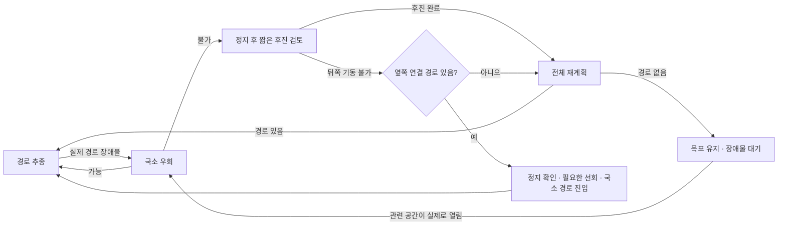

# 주행 정책

주행을 계속 막는 중복 판단을 줄이고, 경로 계획과 실제 구동의 책임을 나눕니다.
실차 실행 명령과 웹 조작은 [팀원 퀵스타트](TEAM_QUICKSTART.md)를 따릅니다.

## 기본 흐름

새 목적지는 일반 A* 계획으로 시작합니다. 국소 우회가 가능하면 전체 경로를 다시
만들지 않습니다. 후진은 최근 실제 주행 이력과 후방 궤적이 확인될 때만 실행합니다.
취소 종결과 실제 정지 확인은 기동 인계 절차이며 별도의 경로 선택 정책이 아닙니다.
뒤쪽 공간이 없으면 후진하지 않습니다. 남은 국소 탐색 예산 안에서 옆쪽의 실제
연결 경로를 확인하고, 필요한 경우 기존 정지·선회 절차를 거쳐 진입합니다.
경로 없이 임의로 돌거나, 정지·제어권 증거가 없는 상태에서 선회하지 않습니다.

5cm 지도 격자가 실제 빈 출발점을 보수적으로 막는 경우에는 로봇 중심 후보만
1cm 간격으로 검사합니다. 원래 점유·unknown·실측·기억 셀의 사각형과 22cm
차체 전체는 그대로 검사하며, 장애물 셀을 줄이지 않습니다. 현재 원형 차체가
실제 점유 사각형과 겹친다는 결과에 한해 반복 전체 계획을 생략하고, 매번 최신
자세의 교차 여부는 다시 확인합니다. 일시적인 raw 스캔 경고·입력 대기·탐색 시간
초과를 영구적인 NoPath로 저장하지 않습니다.

## 공통 조건

- 운용자 정지·비상정지·조이스틱이 임무보다 우선합니다.
- 현재 지도·위치·라이다·오도메트리와 제어권이 유효해야 실제 구동합니다.
- 수신 센서와 설정한 차체 모델을 기준으로 겹치는 경로·명령을 거부합니다.

이 검사는 미검출 물체나 실제 구동 관성까지 포함한 무충돌 보장이 아닙니다.
센서 전달·차체 모델·제동 응답의 차이는 [실차 전달성 시험](GAZEBO_PHYSICAL_TRANSFER.md)으로 구분합니다.

같은 회전 가능 여부를 계획기와 실행기가 따로 판단하지 않습니다. 계획기는 경로의
충돌 여부를 검사하고, 실행기는 필요한 방향 정렬과 실제 구동을 맡습니다.

## 두 가지 기억을 구분

| 정보 | 경로에 적용하는 방법 |
|---|---|
| 라이다로 확인한 실제 장애물 | 장애물 셀로 기억. 시야에서 사라져도 보존하고, 해당 공간이 비었음을 직접 확인하면 해제 |
| 진행 정체·진동·제어기 중단 | 실패한 접근에 추가 비용. 같은 접근을 덜 선호하지만 통로를 폐쇄하지 않음 |

현재 관측과 확정 기억은 같은 원형 차체 계산을 사용합니다. 기억으로 확정됐다는 이유만으로
장애물의 모서리를 더 두껍게 만들지 않습니다. 기억의 보존·직접 빈 공간 확인에 따른 해제는 유지합니다.

실제 장애물 복구는 위 순서를 따릅니다. 장애물 근거가 없는 추종 실패는 기존 목표로
제한 재시도하며, 독립된 실패 사건 3회면 원인을 표시하고 대기합니다. 같은 사건을
중복 집계하거나, 기억의 TTL 때문에 횟수가 줄어들게 하지 않습니다.
이전 실패의 분류용 기록이 없다는 이유만으로 현재 정상인 주행을 차단하지 않습니다.

## 책임

| 구성 요소 | 맡는 일 |
|---|---|
| 웹 | 재고 요청·임무·초기 위치 입력·현재 차단 원인 표시 |
| A* 계획기 | 경로·국소 우회·복구 순서·장애물 기억 및 실패 접근 비용 |
| 경로 실행기 / Nav2 | 액션 인계·방향 정렬·추종·후진 실행 |
| 로봇 motion mux | 제어 우선순위·속도 변화·최종 raw 라이다 충돌 검사·속도 발행 |

세부 조건과 예외는 [문제 해결 트리](NAVIGATION_FAILURE_TREE.md), 실제 통과·실패 기록은
[주행 재현 결과](DRIVING_REPRODUCTION_20261104.md)에 구분합니다. 정책 구현과 단일 시험의
성공을 모든 환경의 완주 보장으로 해석하지 않습니다.
