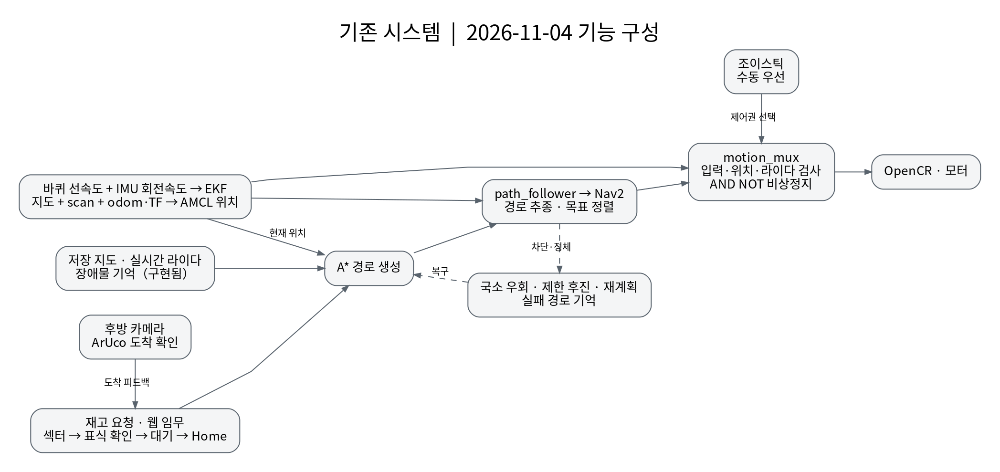
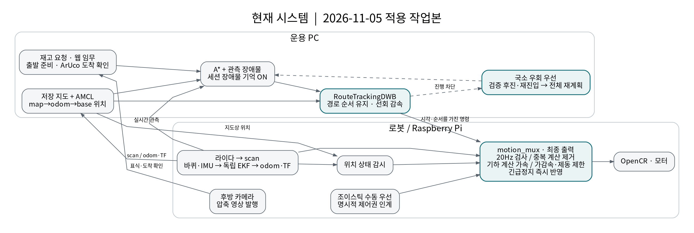
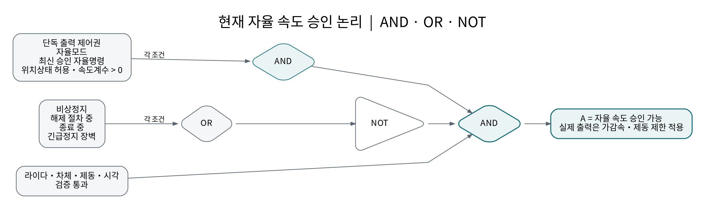
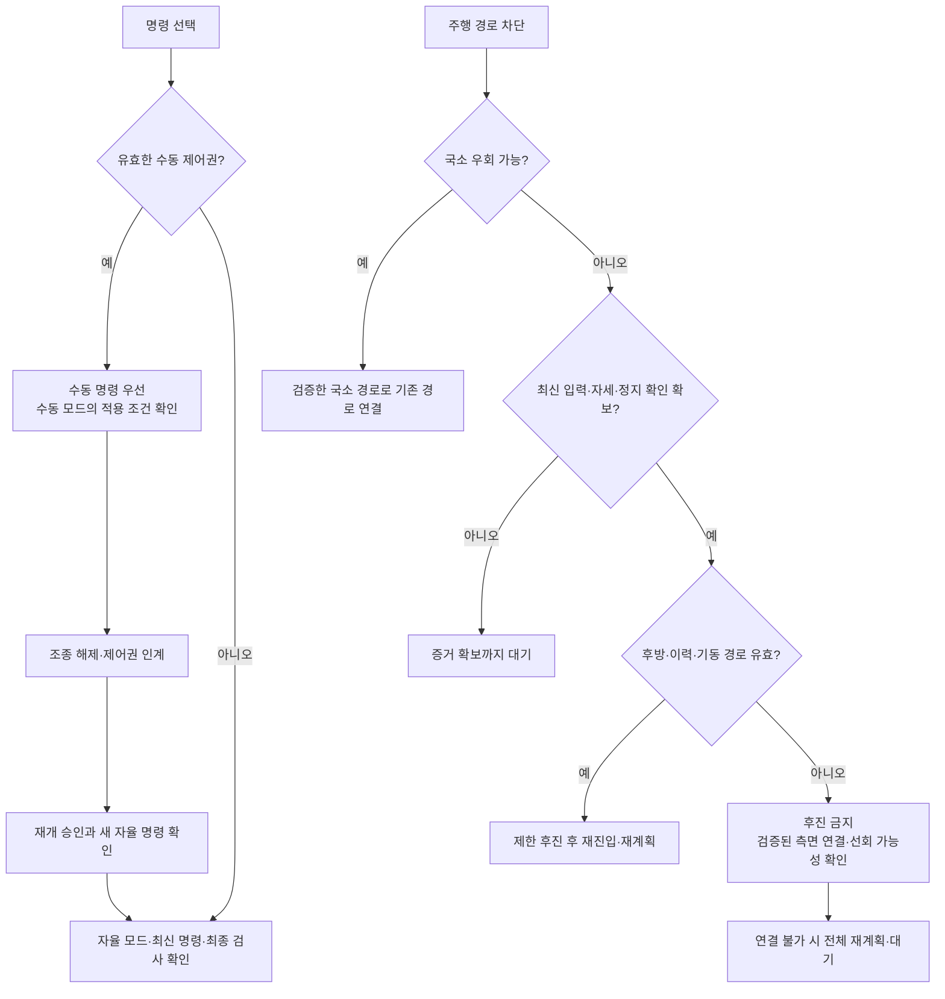
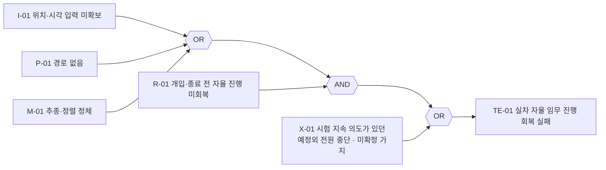

# 기존·현재 시스템 블록 및 논리 비교도

| 항목 | 기준 |
|---|---|
| 문서 번호 | SV-AMR-BLOCK-20261105 |
| 기존 | 2026-11-04 실차 기록 및 최종 저장소 스냅샷 `ad9aa3a` |
| 현재 | `7286c41` 기반 코드와 2026-11-05 명령 끊김 개선 작업본 |
| 분석 기준 | [11월 4일 실차 FTA](PHYSICAL_FTA_REPORT_20261104.md) |
| 결과 연결 | [주행 성능 개선 결과보고서](DRIVING_PERFORMANCE_REPORT_20261105.md) |
| 파라미터 전후 표 | [결과보고서 5절 · 11월 4일·5일 비교](DRIVING_PERFORMANCE_REPORT_20261105.md#5-어제오늘-파라미터-변경-전후) |

기능 구성과 승인 조건을 비교한다. 아래 논리는 소스의 핵심 조건을 요약한 **기능 모델**이며, 소스 전체의 형식 검증이나 실차 성공 판정은 아니다. 문서 작성 중 로봇·웹·시뮬레이션은 종료 상태를 유지했다.

## 1. 기존 시스템



원본: [SVG](diagrams/20261105/existing_system.svg) · [편집용 DOT](diagrams/20261105/existing_system.dot)

기존에도 독립 EKF, AMCL, A*, 장애물 기억, 국소 우회·후진 복구, 수동 우선 중재가 있었다. 그림의 장애물 기억은 **구현된 기능**이며, 11월 4일 현장 문서의 해당 실행에서는 비활성 설정이었다. 모든 당일 시험이 같은 설정이었다고 간주하지 않는다.

주요 문제는 기능의 부재보다 경로 진행 순서, 시작점 차단, 시각 정합 및 정체 후 복구에 있었다. 각 문제의 근거와 미확정 사항은 FTA를 따른다.

## 2. 현재 시스템



원본: [SVG](diagrams/20261105/current_system.svg) · [편집용 DOT](diagrams/20261105/current_system.dot)

강조색은 주요 보완 블록이다. 로봇은 후방 압축 영상을 발행하고, PC의 웹 임무 프로세스가 ArUco 검출·도착 확인을 수행한다.

| 블록 | 기존 대비 변경 |
|---|---|
| 경로 추종 | 경로 진행 순서에 따른 로컬 목표, 선회 전 감속, 출발 가속 제한 |
| 복구 | 국소 우회 우선, 검증된 후진·재진입 및 전체 재계획 인계 보완 |
| 장애물 기억 | 현재 세션에서 활성화. 다시 관측한 빈 공간은 기억에서 해제. 디스크 저장·복원은 비활성 |
| 최종 명령 검사 | 20Hz 출력 주기에서 정상 전체 검사 수행, 검사 중복 제거, 수신·제어권 조회의 간섭 축소 |
| 기하 계산 | 배열 재사용과 선택적 C++ 가속. 차체·제동·최신성 검사 의미 유지 |
| 실행 배치 | 현재 PC와 로봇에 역할 분산. 분산 운용 자체는 기존 저장소에도 존재 |

20Hz는 명목 출력 주기 50ms다. 기하 계산의 일부가 빨라졌다는 사실을 전체 제어 지연 1ms로 해석하지 않는다. 11월 5일 발견한 계산 지연을 11월 4일 실패의 확정 원인으로 소급하지 않는다.

## 3. AND·OR·NOT 읽는 방법

| 기호 | 의미 | 예 |
|---|---|---|
| AND | 모든 조건이 참이어야 참 | 최신 scan **AND** 최신 odom |
| OR | 하나 이상 참이면 참 | 비상정지 **OR** 종료 절차 중 |
| NOT | 입력의 참·거짓을 반전 | **NOT** 비상정지 |

값 `1`은 조건 성립, `0`은 조건 불성립이다. **로그가 없어 미확인인 상태를 0으로 대입하지 않는다.** 논리식의 괄호가 평가 범위를 결정하며 OR는 배타적 OR가 아니다.

## 4. 출발·경로 실행·속도 출력을 분리한 승인 논리

출발 준비가 정상이어도 이후 입력·제어권이 바뀌면 속도 출력은 차단될 수 있다. 세 승인은 서로 다른 시점에 확인한다.


### 4.1 웹 출발 준비

```text
W = ROS 연결
    AND 운용 지도 수신·명시적 지도 불일치 없음
    AND 최신 map→base TF AND 최신 scan AND 최신 odom
    AND 목표·계획·취소 기능 준비
    AND (NOT 위치상태검사필수 OR 최신 자율주행허용 위치상태)
    AND (NOT 전압검사필수 OR 최신 유효 전압·설정 최저전압 충족)
    AND NOT 위치확인동작중
    AND 현재 초기위치 검증상태 유효
    AND 해당 경로의 표식 처리 조건 충족
```

표식 처리 조건에는 섹터 운용 시 ArUco 기능 준비가 포함된다. 일반 주행의 카메라 영상 지연은 경고로 허용할 수 있으며, **최신 카메라 프레임을 모든 주행의 필수 AND 조건으로 두지 않는다.** 도착 시 표식 확인은 별도 단계다. 현재 코드는 과거 초기 위치 입력 실패가 남아 있더라도 현재 지도·TF·위치 상태가 정상으로 검증되면 그 과거 실패만으로 계속 차단하지 않도록 처리한다.

### 4.2 자율 속도 승인



원본: [SVG](diagrams/20261105/autonomous_logic.svg) · [편집용 DOT](diagrams/20261105/autonomous_logic.dot)

```text
Z = 비상정지 OR 해제절차중 OR 종료중 OR 긴급정지장벽

A = 단독 출력 제어권
    AND 자율모드
    AND 최신 승인 자율명령
    AND 자율주행허용 위치상태 AND 위치속도계수 > 0
    AND NOT Z
    AND 라이다·차체·제동·시각 검증 통과
```

그림과 식은 **현재 자율 모드**를 대상으로 한다. 기존에도 제어권·비상정지·최신 명령·위치·라이다 차단 조건이 있었다. 현재는 긴급 정지 장벽과 최종 출력에 대한 기하·제동·입력 증거 확인이 보강됐으며, 기본 출발 조건을 없앤 변경이 아니다.

`A=1`은 자율 속도를 승인할 수 있다는 뜻이다. 실제 출력은 후보 속도, 속도 계수, 출발 램프와 제동 제한에 따라 0일 수도 있다. 실제 모터 이동과 임무 완료는 odom·도착 상태 등으로 별도 확인해야 한다.

단독 `/cmd_vel` 제어권이 없으면 이 mux는 발행을 중단한다. 경쟁 제어기가 있는 상황까지 “항상 0속도를 발행한다”고 해석하지 않는다.

### 4.3 수동 우선과 복구 우선순위



수동은 비상정지의 우회 OR가 아니다. 일반 수동 조종, 표식 정렬, 위치 초기화는 각각 적용 조건이 다르다. **NOT 수동 조종만으로 자율 재개가 보장되지 않는다.** 수동 제어 유효시간 만료는 HOLD로 바뀌며 새 인계·승인·명령이 필요하다. 후방 공간이 없으면 후진하지 않고, 선회도 유효한 기동 공간이 확인될 때 수행한다. 입력·자세·정지 증거가 부족한 경우는 물리적인 후진 불가와 구분하여 대기하며, 검사 없이 선회·재계획 실행으로 넘어가지 않는다.

### 4.4 논리 확인 예

아래는 다른 적용 조건이 정상인 경우다. 웹 출발 준비 `W`와 최종 출력 승인 `A`를 같은 값으로 취급하지 않는다.

| 조건 | 논리 결과 |
|---|---|
| 자율모드, 최신 승인 명령, 검사 통과, 정지 조건 없음 | `A=1` 가능. 실제 속도·이동은 별도 확인 |
| 비상정지 활성 | `Z=1 → NOT Z=0 → A=0`. 수동도 비상정지 우회 불가 |
| 유효 수동 조종 개입 | 자율모드가 해제되어 `A=0`. 적용 수동 조건을 만족하면 수동 우선 |
| 최신 자율 명령 없음 **OR** 라이다 검사 차단 | `W=1`이어도 `A=0` |
| 카메라 영상만 지연, 주행 필수 조건 정상 | 지연 경고로 주행 가능. 표식 도착 확인은 영상 복구 필요 |
| 단독 출력 제어권 없음 | `A=0`, 이 mux는 속도 발행 중단 |

## 5. FTA와 연결한 고장 논리

FTA의 동일한 관찰 구간 `e`에서 다음과 같이 평가한다. 다른 시험에서 발생한 사건을 하나의 AND로 묶지 않는다.



```text
TE(e) = ((I(e) OR P(e) OR M(e)) AND R(e)) OR X(e)

NOT TE(e) = NOT X(e)
            AND (NOT R(e) OR (NOT I(e) AND NOT P(e) AND NOT M(e)))
```

| 관찰 예 | 상위 사건 판정 |
|---|---|
| NoPath가 발생했지만 자율 진행 회복, 예정외 전원 중단 없음 | `P=1, R=0, X=0 → TE=0` |
| NoPath 이후 운용자 개입·시험 종료 전까지 진행 미회복 | `P=1, R=1, X=0 → TE=1` |
| 계획된 하차 대기·정상 종료만 발생 | 이 사실만으로 `R` 또는 `X`를 1로 두지 않음 |

`NOT TE`는 **정의한 고장수목의 상위 사건이 성립하지 않음**을 뜻하며 전체 임무 성공의 충분조건이 아니다. X-01의 예정외 여부·하드웨어 원인은 미확정이다. I·P·M의 상세 사건과 근거 수준은 FTA를 따른다.

## 6. 근거 및 확인 범위

- 웹 준비: `ros2_ws/src/smart_vision_amr/smart_vision_amr/web_mission_server.py`의 `readiness()`.
- 출력 승인·중재: `ros2_ws/src/smart_vision_amr/smart_vision_amr/motion_mux.py`의 `MotionMuxCore.output()` 및 `_publish_output_locked()`.
- 주행·복구 변경과 실차 판정: 결과보고서 1.2·4·8절.
- 고장 논리와 최소절단조합: FTA 4~6절 및 `benchmarks/physical_fta_20261104/fault_tree.json`.

문서의 AND·OR·NOT 식은 가능한 Boolean 조합을 열거해 FTA 전개식·드모르간 보수식의 일치와 예시를 확인했다. 이는 **문서 논리 검사**이며 ROS 실행, 실차 주행, 충돌 방지 또는 전체 소스 등가성 검증을 의미하지 않는다.
