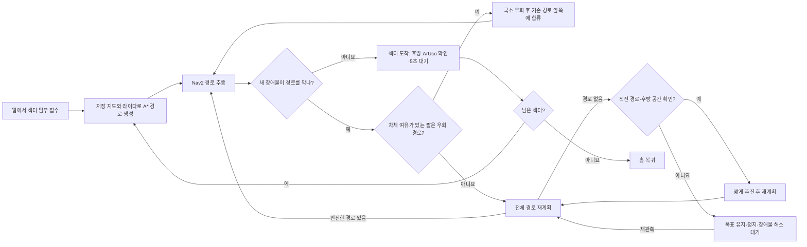

# 팀원용 실차 설치·실행

Ubuntu 22.04 / ROS 2 Humble이 설치된 PC 기준입니다. PC 계정 이름이 달라도 `~`는
자기 홈 폴더이므로 아래 명령을 그대로 사용합니다. 명령 앞에 프롬프트나 `$`를 붙이지 않습니다.

실차는 **ROS_DOMAIN_ID=16**, Gazebo는 **76**입니다. 제공 스크립트가 설정합니다.
실차 운용자는 한 명만 브링업·주행·웹을 실행하고, 다른 팀원은 그 PC의 웹에 접속합니다.
이번 버전은 PC 웹과 로봇의 회전 제어권 메시지를 함께 수정했습니다.
기존 사용자도 **PC와 로봇 양쪽을 업데이트·빌드**해야 합니다(5절).
`~/turtlebot16` 파일이 있다는 사실만으로 로봇 런타임이 최신인 것은 아닙니다.

2026-10-30 실차 시험은 구동기 통신 장애로 중단됐습니다. 재시험 조건과 선택형 Cyclone
비교 절차는 [실차 시험 인수인계](PHYSICAL_TEST_HANDOFF_2026-10-30.md)를 먼저 확인하세요.

| 터미널 | 실행 위치 | 역할 |
|---|---|---|
| 1 | PC에서 SSH → 로봇 | 센서·카메라·독립 EKF·정지 감시·최종 속도 제어 |
| 2 | 로컬 PC | 저장 지도·AMCL·A*·Nav2 |
| 3 | 로컬 PC | 웹 운용·재고 요청 |

## 주행 흐름



라이다·오도메트리·TF·구동 제어가 오래되거나 비상정지 상태라면 이 흐름보다
정지 판단이 우선합니다. 후진은 기록된 직전 경로와 실제 후방 여유가 모두
확인될 때만 실행합니다. 자세한 조건은 [국소 우회](LOCAL_DETOUR.md)와
[실패 접근 재계획](FAILURE_REPLANNING.md)에 있습니다.

## 현재 시험 결과

| 시험 | 결과 | 확인한 범위 |
|---|---|---|
| 기본 교실 Gazebo 웹 임무 | **통과** | Sector 1→2→3→Home, 후방 ArUco, 각 섹터 5초 대기 |
| 지도에 없는 고정 상자 Gazebo 웹 임무 | **통과** | 상자 라이다 관측, 안전 경로 재계획, 실제 우회, Home 복귀 |
| Home 복귀 중 이동 장애물 | **중도 정지·미검증** | v2에서 Sector 1→2→3 뒤 장애물을 감지했지만 안전한 우회 경로가 나오지 않아 정지; 사용자 요청으로 시험 종료. 앞선 v1의 엄격 안전 판정도 미통과 |
| 실차 설정값 비교·실차 주행 | **미실행** | Gazebo 원본 YAML 비교와 실제 로봇 구동은 별도 시험 필요 |

위 표의 Gazebo 결과는 2026-11-02의 **각 1회 시험**이다. 변경 코드와
재시험 결과는 [단계별 검증 기록](classroom_staged_validation.md)과
[SITL 증거](classroom_sitl_evidence_2026-11-02.md)에 갱신한다.

## 1. PC 준비 — 처음 한 번

ROS Humble은 먼저 설치되어 있어야 합니다. 기본 개발 도구와 저장소를 준비합니다.

```bash
sudo apt update
sudo apt install -y git build-essential python3-colcon-common-extensions
mkdir -p ~/Team2_workspace/src
cd ~/Team2_workspace/src
git clone https://github.com/kiki8105/SMART-VISION-AMR.git
cd SMART-VISION-AMR
./scripts/setup_pc_runtime.sh
./scripts/check_classroom_deployment.sh
```

`setup_pc_runtime.sh`는 실차 PC에 필요한 ROS/Python 의존성을 설치하고 이 저장소의
`smart_vision_amr`만 빌드합니다. Gazebo 설치나 시뮬레이션 소스 다운로드는 필요 없습니다.
의존성이 모두 설치되어 있다면 `./scripts/setup_pc_runtime.sh --no-install`로 빌드합니다.
설치·점검 스크립트는 로봇이나 주행 노드를 시작하지 않습니다.

## 2. 로봇 준비 — 처음 한 번

이미 최신 `~/turtlebot16`과 로봇 런타임이 준비되어 있으면 3절로 넘어갑니다.
새 로봇은 ROS Humble과 기존 `~/turtlebot3_ws`가 있어야 합니다.
로봇 본체 터미널이나 공유기 화면에서 `hostname -I`로 **현재 로봇 IP**를 확인합니다.
PC 터미널에서 아래 명령을 실행하고 확인한 IP와 로봇 계정 비밀번호를 입력합니다.
예전에 사용한 `192.168.0.187`은 고정 주소가 아닙니다.

```bash
read -rp '로봇 IP: ' ROBOT_IP
ssh robot@"$ROBOT_IP"
```

**SSH 접속한 로봇 터미널에서**:

```bash
sudo apt update
sudo apt install -y git
cd ~
git clone https://github.com/kiki8105/SMART-VISION-AMR.git
cd ~/SMART-VISION-AMR
./scripts/setup_robot_runtime.sh
./scripts/check_classroom_deployment.sh --robot
```

로봇용 스크립트는 `~/smart_vision_runtime_ws`에 런타임을 빌드합니다.
기존 `~/turtlebot3_ws`는 유지하며 Gazebo·Nav2는 설치하지 않습니다.
`~/turtlebot16`이 없거나 예전 실행 내용을 사용한다면 로봇에서 한 번 만듭니다.

```bash
cat > ~/turtlebot16 <<'SH'
#!/usr/bin/env bash
exec env ENABLE_FRONT_CAMERA="${ENABLE_FRONT_CAMERA:-false}" \
  "$HOME/SMART-VISION-AMR/scripts/robot_bringup_camera_16_ekf.sh" "$@"
SH
chmod +x ~/turtlebot16
```

이 명령은 실행 파일만 준비합니다. 실제 브링업은 다음 절에서 합니다.
기본 LiDAR는 `LDS-03`이며 실물이 `LDS-02`면 `LDS_MODEL=LDS-02 ~/turtlebot16`을 사용합니다.
카메라 경로가 다른 로봇은 [로봇 런타임 설정](hardware_ekf.md)을 확인하세요.

## 3. 매일 실행 — 이 세 터미널을 켜 둡니다

현재 강의실 가벽·마커와 저장 지도 배치가 일치해야 합니다.
주행에는 `ros2_ws/src/smart_vision_amr/maps/classroom_20261030_cleaned.yaml`을 사용합니다.
같은 폴더의 `classroom_20261030_raw.yaml`은 이번 SLAM 원본이고,
`classroom_20261027_cleaned.yaml`은 이전 지도입니다. 모두 보존합니다.
새 지도는 이전 지도보다 좌표계가 약 0.5m 이동하고 조금 회전했으므로 이전
Homepoint·Sector 좌표나 이전 AMCL 위치 추정을 새 지도에 입력하지 마세요.

### 터미널 1 — PC에서 로봇에 접속한 뒤 브링업

```bash
read -rp '로봇 IP: ' ROBOT_IP
ssh robot@"$ROBOT_IP"
```

로그인이 끝나면 **같은 SSH 터미널에서**:

```bash
~/turtlebot16
```

센서·필수 후방 카메라·바퀴/IMU 독립 EKF·정지 감시·motion mux가 실행됩니다.
시작 직후 로봇을 정지시켜 IMU 초기 측정을 마칩니다. 이 터미널은 켜 둡니다.
최근 실차에서는 정지 중에도 약 4분 뒤 OpenCR 통신 오류가 발생했습니다. 재시험 중에는
주행을 켜기 전에 로컬 PC의 별도 터미널에서 5분 연속 수신 검사를 먼저 통과시키세요.

```bash
cd ~/Team2_workspace/src/SMART-VISION-AMR
source /opt/ros/humble/setup.bash
export ROS_DOMAIN_ID=16 ROS_LOCALHOST_ONLY=0
python3 scripts/soak_robot_opencr_16.py --json-out "$HOME/smart_vision_logs/opencr_soak_after_reboot.json"
```

이 검사는 로봇을 움직이지 않습니다. 결과의 `status`가 `passed`가 아니면 임무를 시작하지
말고 해당 오류를 확인하세요. 전압 **10.8V**는 사용자 지정 3셀 LiPo 시험용
출발 기준이며 제조사 보증값이 아닙니다. 실제 부하 전압과 OpenCR 통신 오류를 함께
확인하세요. 저전압 정지 뒤 재설정 기준은 **11.0V**입니다.
전방 카메라는 기본으로 끕니다. 운용 보조 영상이 필요할 때만 위 명령 대신 다음으로 켭니다.

```bash
ENABLE_FRONT_CAMERA=true ~/turtlebot16
```

후방 카메라는 모든 섹터 도착 확인에 필수입니다. 전방을 추가했다면 웹의 두 영상을 확인하고,
전방 없이 운용한다면 후방 영상과 센서·위치 준비 상태를 확인합니다.

### 터미널 2 — 로컬 PC에서 주행

SSH 터미널과 별개로 **PC 터미널을 새로 엽니다**.

```bash
cd ~/Team2_workspace/src/SMART-VISION-AMR
./scripts/check_classroom_deployment.sh --live
./scripts/run_classroom_navigation_16.sh
```

점검이 통과한 뒤 주행을 실행합니다. 점검은 로봇 발행자·센서 시각을 읽기만 하며
PC와 로봇의 시계 차이·전송 지연이 크면 해당 입력과 이유를 표시합니다.
점검 실패 시 그 이유를 해결한 후 다시 실행하세요.
주행은 저장 지도·AMCL·A*·Nav2를 켭니다. PC에 EKF·최종 mux를 중복 실행하지 않습니다.

### 터미널 3 — 로컬 PC에서 웹

```bash
cd ~/Team2_workspace/src/SMART-VISION-AMR
./scripts/run_classroom_web_16.sh
```

운용 PC 브라우저에서 [로봇 운용](http://127.0.0.1:8790/) 또는
[재고 요청](http://127.0.0.1:8790/inventory)에 접속합니다. 웹 도메인은 **16**입니다.
웹 실행만으로 브링업·주행·임무가 자동 시작되지는 않습니다.
이미 같은 PC의 최신 웹 서비스가 8790 포트를 사용 중이면 기존 웹에 접속합니다.

**다른 PC·휴대폰에 공유할 주소:** 같은 Wi-Fi에 연결하고, **웹을 실행한 PC**에서:

```bash
hostname -I
ip -4 -br addr
```

여러 주소가 나오면 로봇·휴대폰과 **같은 Wi-Fi 대역의 PC 주소**를 고릅니다.
예를 들어 그 주소가 `192.168.0.110`이면 운용 주소는
`http://192.168.0.110:8790/`, 재고 요청 주소는
`http://192.168.0.110:8790/inventory`입니다. 팀원이 다른 PC에서 웹을
실행하면 **그 팀원 PC의 주소**로 바꿉니다. 터미널의 `0.0.0.0:8790`은
외부 접속을 받는 바인드 주소이며 브라우저에 입력할 주소가 아닙니다.
`127.0.0.1`은 접속한 기기 자신을 뜻하므로 다른 사람에게 공유하지 않습니다.
로봇 SSH 주소와 웹 주소는 서로 다른 장치의 IP입니다. PC IP가 바뀌면
공유 링크도 바뀝니다. 휴대폰에는 ROS가 필요 없습니다.

## 4. 웹에서 준비하고 출발

1. 지도·전압·후방 영상·위치 준비 상태를 확인합니다. 전방을 켰다면 전방 영상도 확인합니다.
2. 상단의 **초기 위치 지정** 카드에서 로봇의 실제 지도 좌표 X·Y(m)와 차체 전방
   방향 yaw(°)를 확인합니다. 실제 등록 홈에서 후방 카메라가 0번을 바라보면
   **등록 홈 좌표 넣기**를 누르세요. 다른 위치라면 실제 위치와 헤딩을 직접 입력합니다.
   확인란을 체크하고 **AMCL 초기 위치 적용**을 누른 뒤 `AMCL · TF 확인됨`이 표시되는지
   확인합니다. 이 동작은 비상정지 해제·회전·자동 출발을 하지 않습니다.
   버튼이 비활성화되면 **출발 준비 초기화**에서 정지·센서·지도·제어권 중 막힌 단계를
   확인하세요. 센서와 위치가 안정된 뒤 비상정지를 명시적으로 해제합니다.
3. **초기 위치 지정**을 완료했다면 **자세 초기화**를 다시 누를 필요는 없습니다.
   별도의 자동 위치 확인이 필요할 때만, 실제 등록 홈에서 **자세 초기화**로 저속
   회전·위치 확인을 진행하고 완료를 기다립니다. 이 기능도 위치만 확인하며 자동
   출발하지 않습니다. 로봇을 들어 옮기거나 전원을 다시 켰다면 이전 위치 추정을
   그대로 사용하지 말고 다시 지정하거나 확인합니다.
4. 위치 준비 상태를 확인하고 재고 관리자가 `/inventory`에서 Sector 요청을 등록합니다.
5. 로봇 운용자가 적재를 확인하고 임무를 출발시킵니다. 위치 확인만으로 자동 출발하지 않습니다.

새 지도에서 Home은 `(-0.188, -0.220)m`, 차체 전방 yaw `-0.028rad`이며
후방 카메라가 0번을 봅니다. Sector 1은 `(1.200, 0.575)m`, Sector 2는
`(1.450, -2.650)m`, Sector 3은 `(-0.250, -1.980)m`입니다. 이 값은
벽의 마커 위치가 아니라 로봇이 마커를 관측할 위치입니다.
저장된 배송 Homepoint가 등록 Home과 다르다는 안내가 나오면 **등록된 홈으로 복원**을
먼저 누릅니다. 이는 배송 기준점 복원이며 차량을 이동시키거나 현재 추정 위치를 바꾸지 않습니다.
Sector 1~3은 **후방 카메라**로 해당 번호의 아루코를 확인합니다. 실차 기본 설정은
표식을 찾으면 영상 가로 중앙에서 ±15% 폭 안으로 **최대 3초, 약 17° 이내** 저속
정렬합니다. 그 안에서 멈춰 최신 영상 3개 이상과 0.6초 안정성이 확인되면 도착으로
인정합니다. 중앙 보정 한도에 도달했는데 표식이 여전히 범위 밖이면 더 회전하지
않고 목표를 유지한 채 임무를 일시정지합니다. 표식 인식만으로 도착 처리하지 않습니다.
이 판정은 벽과 정확한 직각 정렬을 보증하지 않습니다.
주변 회전 여유·위치 신뢰도·전압·정지 검사는 그대로 적용됩니다.
Home 초기화는 등록 좌표·방향과 LiDAR·지도를 대조하며, 0번 표식 검출은 보조 근거입니다.
Home 복귀 완료는 지도상 Home 위치·방향과 실제 정지를 확인합니다.
전방 카메라는 운용 보조용이며 도착 확인의 필수 카메라는 아닙니다.
수동 개입은 웹 조이스틱을 사용합니다. 조이스틱·정지는 임무와 위치 보정 회전보다 우선하며,
비상정지 해제나 자세 초기화만으로 임무가 시작되지 않습니다.

## 5. 업데이트와 종료

**로컬 PC**, 주행을 종료한 상태에서:

```bash
cd ~/Team2_workspace/src/SMART-VISION-AMR
git pull --ff-only
./scripts/setup_pc_runtime.sh --no-install
```

**SSH 접속한 로봇**, 브링업을 종료한 상태에서:

```bash
cd ~/SMART-VISION-AMR
git pull --ff-only
./scripts/setup_robot_runtime.sh --no-install
```

의존성 추가 안내가 있는 업데이트는 `--no-install`을 빼고 실행합니다.
실행 중인 프로세스는 코드만 받아도 바뀌지 않으므로 세 터미널을 다시 켭니다.
웹 화면도 새로고침해 최신 버튼과 안내를 불러옵니다.
새로 SLAM한 지도를 적용할 때도 SLAM 터미널을 `Ctrl+C`로 종료해 지도를 저장한 뒤,
PC의 기존 주행·웹을 종료하고 이 절의 최신 저장소를 빌드해 다시 실행합니다.
새 좌표계의 **초기 위치 지정**을 다시 완료해야 합니다. 새 웹 설정은
`~/.config/smart-vision-amr/classroom-16-20261030.json`을 사용해 이전 지도에
저장된 Homepoint를 재사용하지 않습니다.
상시 실행 웹 서비스를 설치한 PC라면 수동 웹과 중복 실행하지 않고 다음으로 웹을 재시작합니다.

```bash
systemctl --user restart smart-vision-classroom-web.service
```

서비스를 설치하지 않았다면 터미널 3의 실행 명령을 사용합니다.
종료할 때는 웹에서 먼저 정지하고, 터미널 **3 → 2 → 1** 순서로 `Ctrl+C`를 누릅니다.
브링업 종료 후 SSH를 끝내려면 `exit`를 입력합니다.

## 6. 점검·선택 기능

[배포 점검 안내](DEPLOYMENT_CHECK.md)는 카메라 장착 위치의 기본 좌표 관례와 실측값 지정 방법,
올바른 작업공간·도메인·시계·발행자 확인 방법과
오프라인 검증 범위를 설명합니다. 입력 대기나 TF 오류가 계속되면
[주행 시작 문제 해결](classroom_navigation_startup.md)을 참고하세요.
`/map`은 지도 서버 하나, `/odom`은 로봇 EKF 하나, `/cmd_vel`은 로봇 mux 하나가 발행해야 합니다.

`setup_pc_runtime.sh --no-install`에서 `Missing ROS package`가 나오면 필요한 의존성이
ROS Humble과 선택한 작업공간 양쪽에서 발견되지 않은 것입니다. `--no-install`을 빼고
`./scripts/setup_pc_runtime.sh`를 실행하면 의존성 설치와 빌드를 함께 진행합니다.
이미 같은 작업공간에 빌드된 TurtleBot3 의존성은 검사에 포함합니다.

선택 PyQt 조종기는 `sudo apt install python3-pyqt5`로 준비한 후
`./scripts/run_classroom_controller_16.sh`를 실행합니다. 수동 운전은 웹 조이스틱을 사용합니다.

Gazebo를 시험할 때만 `./scripts/setup_sim.sh`로 시뮬레이션 의존성과 공식 소스를 준비합니다.
이후 별도 PC 터미널에서 `./scripts/run_web_mission_sim.sh`, `./scripts/run_web_mission.sh`를
각각 실행하고 도메인 **76**을 사용합니다. [Gazebo 안내](GAZEBO.md)를 참고하세요.

이번 실측 강의실 지도와 더 좁은 통로를 시험할 때에는 일반 미로 대신 터미널 1에서
`./scripts/run_classroom_replay_sim.sh --stress gui:=true`, 터미널 2에서
`./scripts/run_classroom_replay_web.sh`를 실행합니다. 웹은
`http://127.0.0.1:8791/`이며 실제 로봇 도메인 16에는 연결되지 않습니다.
[강의실 Gazebo 재현과 검증 범위](classroom_replay_simulation.md)를 참고하세요.
