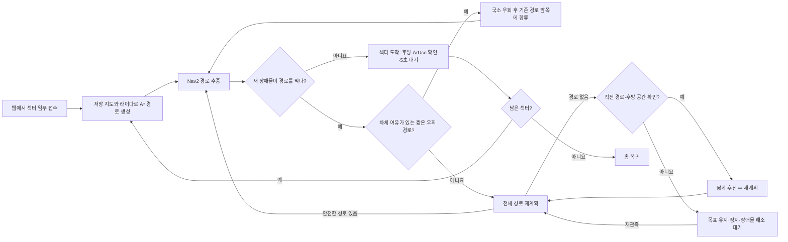

# 팀원용 실차 설치·실행

Ubuntu 22.04 / ROS 2 Humble이 설치된 PC 기준입니다. PC 계정 이름이 달라도 `~`는
자기 홈 폴더이므로 아래 명령을 그대로 사용합니다. 명령 앞에 프롬프트나 `$`를 붙이지 않습니다.

실차는 **ROS_DOMAIN_ID=16**입니다. 일반 Gazebo 실습은 **76**, 격리된 결함·반복
검증은 **176**을 사용합니다. 각 스크립트가 자신의 도메인을 설정합니다.
실차 운용자는 한 명만 브링업·주행·웹을 실행하고, 다른 팀원은 그 PC의 웹에 접속합니다.
이번 버전은 PC 웹과 로봇의 회전 제어권 메시지를 함께 수정했습니다.
기존 사용자도 **PC와 로봇 양쪽을 업데이트·빌드**해야 합니다(5절).
`~/turtlebot16` 파일이 있다는 사실만으로 로봇 런타임이 최신인 것은 아닙니다.

2026-10-30 실차 시험은 구동기 통신 장애로 중단됐습니다. 재시험 조건과 선택형 Cyclone
비교 절차는 [실차 시험 인수인계](PHYSICAL_TEST_HANDOFF_2026-10-30.md)를 먼저 확인하세요.
이후 팀원 보고에서는 **웹 재고 요청 → Sector 2 → Home 왕복 1회**가 완료됐습니다.
두 번째 시도는 비상정지·AMCL 위치/방향 불확실도 때문에 출발하지 못했습니다.
첫 주행 영상은 팀원이 보유하며 이 저장소에는 측정 로그가 없어, 장애물 회피나
반복 재현성의 실차 합격 근거로 취급하지 않습니다. 아래 반복 시험 절차를 따르세요.

| 터미널 | 실행 위치 | 역할 |
|---|---|---|
| 1 | PC에서 SSH → 로봇 | 센서·카메라·독립 EKF·정지 감시·최종 속도 제어 |
| 2 | 로컬 PC | 저장 지도·AMCL·A*·Nav2 |
| 3 | 로컬 PC | 웹 운용·재고 요청 |

## 주행 흐름

PPT용 요약은 [A*·TurtleBot3 시스템 비교 한 장 그림](figures/navigation_system_comparison.png)에 있습니다.



라이다·오도메트리·TF·구동 제어가 오래되거나 비상정지 상태라면 이 흐름보다
정지 판단이 우선합니다. 후진은 기록된 직전 경로와 실제 후방 여유가 모두
확인될 때만 실행합니다. 자세한 조건은 [국소 우회](LOCAL_DETOUR.md)와
[실패 접근 재계획](FAILURE_REPLANNING.md)에 있습니다.

## 현재 시험 결과

| 시험 | 결과 | 확인한 범위 |
|---|---|---|
| 기본 교실 Gazebo 웹 임무 | **통과** | Sector 1→2→3→Home, 후방 ArUco, 각 섹터 5초 대기 |
| 지도에 없는 고정 상자 Gazebo 웹 임무 | **통과** | 상자 라이다 관측, 안전 경로 재계획, 실제 우회, Home 복귀 |
| Home 복귀 중 이동 장애물 | **악조건 Gazebo 엄격 PASS 2회** | 독립 실행 두 회차 모두 웹 1→2→3→Home, 출발 20/20, 실제 25cm 상자 생성·4단계 이동·라이다 관측·경로 변경·우회·제거·지도 빨간 표시 소멸, 안전 위반 0. 이동 상자 최소 차체 여유 0.124/0.178m. 실차는 미검증 |
| 같은 프로세스 Sector 2→Home 재출발 | **Gazebo 2회 통과** | 웹 임무 2회, 출발마다 pre-arm 20/20, 위치 재지정·비상정지 해제 절차 확인 |
| 재고 API Sector 2→Home 재출발 | **Gazebo 2회 통과** | 관리자 요청·운용자 적재 확인·배송 완료, 출발마다 pre-arm 20/20 |
| 기존 Sector 2 X=1.450m 악조건 1→2→3→Home | **1회 통과, 이후 재시험 실패** | 첫 회는 마커·5초 대기·Home 확인. 다음 회는 웹상 완료여도 Gazebo 실제 Sector 2·Home 방향 오차가 엄격 기준을 초과 |
| Sector 2 X=1.525m 악조건 1→2→3→Home | **수정 후 엄격 판정 3회 통과** | 매 출발 20/20, 세 섹터 마커·5초 대기·Home, 고정 상자 우회·안전 위반 0. 두 번째 회차에서 연속 위치 기반 출발 복구 4회 작동. 세 번째 회차는 Sector 3 전 약 2분 재계획 대기와 Home 재계획 반복 끝에 완료했으므로 지연 개선이 남음. 순서 변경 1→3→2는 별도로 2회, Home 이동 장애물은 독립 2회 엄격 통과했고, 실차 반복은 별도 검증 중 |
| 악조건 교실 1→3→2→Home | **엄격 판정 2회 통과** | 매 출발 pre-arm 20/20, 순서대로 세 섹터 후방 마커·5초 대기·Home, 고정 상자 실제 재계획 우회, 안전 위반 0. 차체 최소 여유 0.0699/0.0873m. 실차 반복 성능은 미검증 |
| 실차 Sector 2 왕복 | **팀원 보고 1회 완료** | 웹 재고 요청·왕복 주행 영상 있음. 장애물 없음; 두 번째 출발은 비상정지와 위치/방향 불확실도로 중단 |
| 실차 장애물·반복 검증 | **미검증** | 10/30 지도·초기 위치를 맞춘 상태에서 반복 시험 필요 |
| 실차 설정값 Gazebo 비교 | **엄격 PASS 1회 (저장소 설정값)** | 체크인된 Nav2·교실 노드·EKF 설정값과 시뮬 생성본의 시계 항목 제외 일치 9/9, 웹 1→2→3→Home, 출발 20/20, 안전 위반 0. 중간 재계획 대기 후 자율 복구. 실차의 현재 ROS 파라미터·하드웨어 성능은 미검증 |
| 런타임 장애물 기억 Stage 20 | **Gazebo PASS 1회** | 악조건 교실 웹 1→2→3→Home, 출발 전 검사 통과, 안전 위반 0. 기억 ON·라이다 Speckle 필터 OFF |
| 런타임 장애물 기억 Stage 21·22 | **Gazebo 각 PASS 1회** | Sector 2 단독→Home 및 1→2→3→Home 통합, 출발 전 검사 통과, 안전 위반 0. 기억 ON·필터 OFF |
| 런타임 장애물 기억 Stage 23 | **Gazebo PASS 1회** | 1→2→3→Home 통합 주행 중 이동 상자를 추가·이동·제거했다. 실시간 장애물 관측과 경로 대응, 제거 뒤 2.604초 내 관측 해제, 충돌 여유 0.10278m 이상을 확인했다. 기억 ON·필터 OFF |
| 런타임 장애물 기억 Stage 24 | **Gazebo PASS 2회** | 1→2→3→Home에서 Sector 1의 상자를 기억했고, Sector 2 첫 계획 시 상자는 라이다 시야 밖이었다. Sector 2 이동 중 상자를 치운 뒤 유효한 빈 공간 스캔으로 해당 기억 셀이 지워졌지만 기존 경로를 유지했다. 제거 시점과 최종 전역 계획 횟수는 두 회차 모두 2→2였고, Home 복귀까지 완료했다. 기억 ON·필터 OFF |

위 표의 초기 통합·고정 상자 결과는 2026-11-02의 **각 1회 시험**이다. 필터 선택 기능의 A/B 결과와 원본/오프라인 재판정 차이는 [라이다 필터 A/B](LASER_FILTER_AB.md)를 참조한다. 재출발
결과와 엄격 Gazebo 판정은 별도 반복 시험이며, 웹에서 완료로 보여도 독립적인
실제 위치·방향 판정이 실패하면 합격으로 계산하지 않는다. 변경 코드와
재시험 결과는 [단계별 검증 기록](classroom_staged_validation.md)과
[SITL 증거](classroom_sitl_evidence_2026-11-02.md),
[반복 검증 기록](REPEAT_VALIDATION_2026-11-02.md)에 갱신한다.

## 1. PC 준비 — 처음 한 번

ROS Humble은 먼저 설치되어 있어야 합니다. 기본 개발 도구와 저장소를 준비합니다.
**기존 `~/Team2_workspace`가 있는 PC에서 처음부터 다시 설치할 때는**
주행·웹·Gazebo 터미널을 Ctrl+C로 종료합니다. 다음 삭제 절차는 **로컬 PC에서만**
진행하며 SSH로 접속한 로봇에서는 실행하지 않습니다. `~/Team2_workspace` 전체를
지우므로 `src`의 기존 소스, `build`·`install`·`log`, 원본 SLAM 지도인 `maps`,
`diagnostics`와 `distribution` 파일도 함께 삭제됩니다. **현재 운용 지도와 과거
SLAM 지도, 선별한 시험 증거는 GitHub 저장소에 포함**되어 새 클론에서 다시 받습니다
([지도 아카이브](../archive/README.md), [시험 아카이브](../benchmarks/archive_20261026/README.md)).
개인 소스·커밋하지 않은 수정·미추적 파일, 선별 아카이브에 없는 로컬 로그나
배포 산출물을 보존하려면 삭제 전에 작업공간 밖에 복사하세요. 처음 설치하는 PC는
삭제 단계를 건너뛰고 바로 설치 명령으로 갑니다.

```bash
# 로컬 PC: 출력이 있다면 필요한 개인 변경을 먼저 별도로 저장합니다.
if [ -d "$HOME/Team2_workspace/src/SMART-VISION-AMR/.git" ]; then
  git -C "$HOME/Team2_workspace/src/SMART-VISION-AMR" status --short
fi
cd "$HOME"
rm -rf -- "$HOME/Team2_workspace"
```

`cd "$HOME"`은 삭제 대상 폴더에서 빠져나오기 위해 필요합니다. 이 명령은
`~/turtlebot3`, `~/.ros`, 로봇의 `~/turtlebot3_ws`와 홈 폴더의 웹 설정
(`~/.config/smart-vision-amr`)은 지우지 않습니다.

같은 PC 터미널에서 새 작업공간을 만들고 클론·설치합니다.

```bash
sudo apt update
sudo apt install -y git build-essential python3-colcon-common-extensions
mkdir -p ~/Team2_workspace/src
cd ~/Team2_workspace/src
git clone https://github.com/kiki8105/SMART-VISION-AMR.git
cd SMART-VISION-AMR
./scripts/setup_pc_runtime.sh
./scripts/check_classroom_deployment.sh
```

`setup_pc_runtime.sh`는 실차 PC에 필요한 ROS/Python 의존성을 설치하고 이 저장소의
`smart_vision_amr`만 빌드합니다. Gazebo 설치나 시뮬레이션 소스 다운로드는 필요 없습니다.
의존성이 모두 설치되어 있다면 `./scripts/setup_pc_runtime.sh --no-install`로 빌드합니다.
설치·점검 스크립트는 로봇이나 주행 노드를 시작하지 않습니다.
전체 작업공간을 지운 뒤 Gazebo도 다시 쓰려면 [Gazebo 설치 안내](GAZEBO.md)에
따라 `./scripts/setup_sim.sh`를 별도로 실행합니다. 실차만 사용할 때는 필요 없습니다.

## 2. 로봇 준비 — 처음 한 번

이미 최신 `~/turtlebot16`과 로봇 런타임이 준비되어 있으면 3절로 넘어갑니다.
새 로봇은 ROS Humble과 기존 `~/turtlebot3_ws`가 있어야 합니다.
로봇 본체 터미널이나 공유기 화면에서 `hostname -I`로 **현재 로봇 IP**를 확인합니다.
PC 터미널에서 아래 명령을 실행하고 확인한 IP와 로봇 계정 비밀번호를 입력합니다.
예전에 사용한 `192.168.0.187`은 고정 주소가 아닙니다.

```bash
read -rp '로봇 IP: ' ROBOT_IP
ssh robot@"$ROBOT_IP"
```

**SSH 접속한 로봇 터미널에서** 기존 `~/SMART-VISION-AMR`을 새로 클론할
경우, 기존 브링업·카메라를 Ctrl+C로 종료하고 다음 프로젝트 경로만 정리합니다.
로봇의 `~/turtlebot3_ws`는 하드웨어 브링업에 필요하므로 **삭제하지 않습니다.**
`~/smart_vision_runtime_ws` 전체도 유지합니다. 로봇을 처음 준비한다면
이 정리 단계는 건너뜁니다.

```bash
if [ -d "$HOME/SMART-VISION-AMR/.git" ]; then
  git -C "$HOME/SMART-VISION-AMR" status --short
fi
rm -rf -- "$HOME/SMART-VISION-AMR" \
  "$HOME/smart_vision_runtime_ws/src/smart_vision_amr" \
  "$HOME/smart_vision_runtime_ws/build/smart_vision_amr" \
  "$HOME/smart_vision_runtime_ws/install/smart_vision_amr"
```

로봇에 따로 수정한 설정 파일이 있다면 삭제 전에 백업합니다. 정리 후
**같은 로봇 터미널에서** 새 클론과 런타임 설치를 진행합니다.

```bash
sudo apt update
sudo apt install -y git
cd ~
git clone https://github.com/kiki8105/SMART-VISION-AMR.git
cd ~/SMART-VISION-AMR
./scripts/setup_robot_runtime.sh
./scripts/check_classroom_deployment.sh --robot
```

로봇용 스크립트는 `~/smart_vision_runtime_ws`에 런타임을 빌드합니다.
기존 `~/turtlebot3_ws`는 유지하며 Gazebo·Nav2는 설치하지 않습니다.
`~/turtlebot16`이 없거나 예전 실행 내용을 사용한다면 로봇에서 한 번 만듭니다.

```bash
cat > ~/turtlebot16 <<'SH'
#!/usr/bin/env bash
exec env ENABLE_FRONT_CAMERA="${ENABLE_FRONT_CAMERA:-false}" \
  "$HOME/SMART-VISION-AMR/scripts/robot_bringup_camera_16_ekf.sh" "$@"
SH
chmod +x ~/turtlebot16
```

이 명령은 실행 파일만 준비합니다. 실제 브링업은 다음 절에서 합니다.
기본 LiDAR는 `LDS-03`이며 실물이 `LDS-02`면 `LDS_MODEL=LDS-02 ~/turtlebot16`을 사용합니다.
카메라 경로가 다른 로봇은 [로봇 런타임 설정](hardware_ekf.md)을 확인하세요.

## 3. 매일 실행 — 이 세 터미널을 켜 둡니다

현재 강의실 가벽·마커와 저장 지도 배치가 일치해야 합니다.
주행에는 `ros2_ws/src/smart_vision_amr/maps/classroom_20261030_cleaned.yaml`을 사용합니다.
같은 폴더의 `classroom_20261030_raw.yaml`은 이번 SLAM 원본이고,
`classroom_20261027_cleaned.yaml`은 이전 지도입니다. 모두 보존합니다.
새 지도는 이전 지도보다 좌표계가 약 0.5m 이동하고 조금 회전했으므로 이전
Homepoint·Sector 좌표나 이전 AMCL 위치 추정을 새 지도에 입력하지 마세요.
**10/27 지도에서 사용하던 PC 주행·웹 프로세스가 남아 있으면 새 파일을 받아도
실행 중인 지도가 바뀌지 않습니다.** 주행 중지 후 5절에 따라 PC 코드를 갱신하고
터미널 2·3을 다시 시작하세요. 새 PC에서도 터미널 2의 기본 스크립트가
`classroom_20261030_cleaned.yaml`을 선택하는지 먼저 확인합니다.

### 터미널 1 — PC에서 로봇에 접속한 뒤 브링업

```bash
read -rp '로봇 IP: ' ROBOT_IP
ssh robot@"$ROBOT_IP"
```

로그인이 끝나면 **같은 SSH 터미널에서**:

```bash
~/turtlebot16
```

센서·필수 후방 카메라·바퀴/IMU 독립 EKF·정지 감시·motion mux가 실행됩니다.
시작 직후 로봇을 정지시켜 IMU 초기 측정을 마칩니다. 이 터미널은 켜 둡니다.
최근 실차에서는 정지 중에도 약 4분 뒤 OpenCR 통신 오류가 발생했습니다. 재시험 중에는
주행을 켜기 전에 로컬 PC의 별도 터미널에서 3분 연속 수신 검사를 먼저 통과시키세요.

```bash
cd ~/Team2_workspace/src/SMART-VISION-AMR
source /opt/ros/humble/setup.bash
export ROS_DOMAIN_ID=16 ROS_LOCALHOST_ONLY=0
python3 scripts/soak_robot_opencr_16.py --duration 180 --json-out "$HOME/smart_vision_logs/opencr_soak_after_reboot.json"
```

이 검사는 로봇을 움직이지 않습니다. 3분 통과는 과거 약 4분 뒤에 발생한
오류가 재발하지 않음을 보증하지 않습니다. 더 길게 확인하려면 `--duration 300`으로
5분 검사합니다. 결과의 `status`가 `passed`가 아니면 임무를 시작하지
말고 해당 오류를 확인하세요. 전압 **10.8V**는 사용자 지정 3셀 LiPo 시험용
출발 기준이며 제조사 보증값이 아닙니다. 실제 부하 전압과 OpenCR 통신 오류를 함께
확인하세요. 저전압 정지 뒤 재설정 기준은 **11.0V**입니다.
전방 카메라는 기본으로 끕니다. 운용 보조 영상이 필요할 때만 위 명령 대신 다음으로 켭니다.

```bash
ENABLE_FRONT_CAMERA=true ~/turtlebot16
```

후방 카메라는 모든 섹터 도착 확인에 필수입니다. 전방을 추가했다면 웹의 두 영상을 확인하고,
전방 없이 운용한다면 후방 영상과 센서·위치 준비 상태를 확인합니다.

### 터미널 2 — 로컬 PC에서 주행

SSH 터미널과 별개로 **PC 터미널을 새로 엽니다**.

```bash
cd ~/Team2_workspace/src/SMART-VISION-AMR
./scripts/check_classroom_deployment.sh --live
./scripts/run_classroom_navigation_16.sh
```

점검이 통과한 뒤 주행을 실행합니다. 점검은 로봇 발행자·센서 시각을 읽기만 하며
PC와 로봇의 시계 차이·전송 지연이 크면 해당 입력과 이유를 표시합니다.
점검 실패 시 그 이유를 해결한 후 다시 실행하세요.
주행은 저장 지도·AMCL·A*·Nav2를 켭니다. PC에 EKF·최종 mux를 중복 실행하지 않습니다.
이 스크립트는 라이다로 확인한 장애물을 **현재 주행 프로세스 안에서 섹터 간 기억**합니다.
같은 지도 셀을 5회 이상·최소 2초 동안 장애물로 확인해야 확정하며, 해당 셀을
유효한 라이다 레이가 5회 이상·최소 2초 동안 비어 있다고 직접 확인해야 삭제합니다.
시야에서 사라졌다는 이유만으로 기억을 지우지 않습니다. 기본 인자는
`memory_enabled:=true memory_persist_to_disk:=false`이므로 주행 프로세스를 재시작하면
기억은 비워지고, 저장한 SLAM 지도는 수정되지 않습니다. 단발 반사 제거용
`laser_filter_for_change_memory`는 기본 **OFF**입니다. 실패한 접근을 잠시 피하는
`failure_memory_enabled`는 장애물 셀 기억과 별도 기능입니다.
자세한 동작은 [저장 지도에 없는 실제 장애물](live_obstacle_avoidance.md)을 확인하세요.
PC의 **별도 진단 터미널**에서 다음을 한 줄씩 실행하면 실제 지도 서버의 파일과
중복 발행자를 확인할 수 있습니다. `yaml_filename` 결과에는 `20261030_cleaned.yaml`이
들어 있어야 하고, `/map` 발행자는 `/map_server` **하나**여야 합니다.

```bash
source /opt/ros/humble/setup.bash
source ~/Team2_workspace/install/local_setup.bash
export ROS_DOMAIN_ID=16 ROS_LOCALHOST_ONLY=0
ros2 param get /map_server yaml_filename
ros2 topic info /map -v
ros2 param get /change_memory memory_enabled
ros2 param get /change_memory memory_persist_to_disk
ros2 param get /change_memory scan_topic
```

마지막 세 결과는 각각 `True`, `False`, `/scan`이어야 합니다. `False`인 기억 설정으로
실행 중이라면 터미널 2의 오래된 주행 프로세스를 종료하고 최신 스크립트를 다시 실행합니다.

웹 운용지도의 원본·정리된 지도에서 현재 라이다 관측은 **빨간 셀**, 확인되어 섹터 사이에 남는 기억은 **진한 빨간 셀**로 보입니다. 기억은 시야 이탈로 지워지지 않고 해당 위치를 직접 빈 공간으로 확인해야 해제됩니다. 상세 기준은 [저장 지도에 없는 실제 장애물](live_obstacle_avoidance.md)을 확인하세요.

`20261027`이 나오거나 `/map` 발행자가 둘 이상이면 임무를 시작하지 마세요.
SLAM/Cartographer가 실행 중이라면 해당 터미널에서 종료하고, 터미널 2·3의
기존 프로세스를 `Ctrl+C`로 끝낸 뒤 현재 스크립트로 다시 실행합니다.

### 터미널 3 — 로컬 PC에서 웹

```bash
cd ~/Team2_workspace/src/SMART-VISION-AMR
./scripts/run_classroom_web_16.sh
```

운용 PC 브라우저에서 [로봇 운용](http://127.0.0.1:8790/) 또는
[재고 요청](http://127.0.0.1:8790/inventory)에 접속합니다. 웹 도메인은 **16**입니다.
웹 실행만으로 브링업·주행·임무가 자동 시작되지는 않습니다.
이미 같은 PC의 최신 웹 서비스가 8790 포트를 사용 중이면 기존 웹에 접속합니다.

**다른 PC·휴대폰에 공유할 주소:** 같은 Wi-Fi에 연결하고, **웹을 실행한 PC**에서:

```bash
hostname -I
ip -4 -br addr
```

여러 주소가 나오면 로봇·휴대폰과 **같은 Wi-Fi 대역의 PC 주소**를 고릅니다.
예를 들어 그 주소가 `192.168.0.110`이면 운용 주소는
`http://192.168.0.110:8790/`, 재고 요청 주소는
`http://192.168.0.110:8790/inventory`입니다. 팀원이 다른 PC에서 웹을
실행하면 **그 팀원 PC의 주소**로 바꿉니다. 터미널의 `0.0.0.0:8790`은
외부 접속을 받는 바인드 주소이며 브라우저에 입력할 주소가 아닙니다.
`127.0.0.1`은 접속한 기기 자신을 뜻하므로 다른 사람에게 공유하지 않습니다.
로봇 SSH 주소와 웹 주소는 서로 다른 장치의 IP입니다. PC IP가 바뀌면
공유 링크도 바뀝니다. 휴대폰에는 ROS가 필요 없습니다.

## 4. 웹에서 준비하고 출발

1. 지도·전압·후방 영상·위치 준비 상태를 확인합니다. 전방을 켰다면 전방 영상도 확인합니다.
2. 상단 **출발 준비**의 요약을 확인하고, 막힌 항목은 **막힌 항목·해결 방법**에서
   펼쳐 봅니다. 로봇을 **실제 등록 홈 표시 위치**에 세우고 후방 카메라가 0번을
   바라보며 정지해 있다면 **초기 위치 지정 → 등록 홈에서 시작** 확인란을 체크하고
   **등록 홈으로 초기 위치 지정**을 누릅니다. 저장된 X·Y(m)와 차체 전방 yaw가
   한 번에 AMCL에 전달됩니다. 웹의 `HOME_REACHED`는 허용 오차 내 도착이므로 이
   버튼을 눌러도 되는 물리적 위치의 증거가 아닙니다. 실제 홈과 조금이라도 다른
   곳에 있다면 **홈이 아니면 X·Y·방향 직접 입력**을 펼쳐 지도에서 확인한 실제
   위치·방향을 넣고 **AMCL 초기 위치 적용**을 누릅니다. `AMCL · TF 확인됨`과
   위치 신뢰도 회복을 기다립니다. 초기 위치 지정은 비상정지 해제·회전·자동 출발을
   하지 않습니다.
   버튼이 비활성화되면 **출발 준비 초기화**에서 정지·센서·지도·제어권 중 막힌 단계를
   확인하세요. 센서와 위치가 안정된 뒤 비상정지를 명시적으로 해제합니다.
3. **초기 위치 지정**을 완료했다면 **자세 초기화**를 다시 누를 필요는 없습니다.
   별도의 자동 위치 확인이 필요할 때만, 실제 등록 홈에서 **자세 초기화**로 저속
   회전·위치 확인을 진행하고 완료를 기다립니다. 이 기능도 위치만 확인하며 자동
   출발하지 않습니다. 로봇을 들어 옮기거나 전원을 다시 켰다면 이전 위치 추정을
   그대로 사용하지 말고 다시 지정하거나 확인합니다.
4. 위치 준비 상태를 확인하고 재고 관리자가 `/inventory`에서 Sector 요청을 등록합니다.
5. 로봇 운용자가 적재를 확인하고 임무를 출발시킵니다. 위치 확인만으로 자동 출발하지 않습니다.

### Sector 2 왕복 후 같은 시험을 다시 할 때

로봇이 **실제로 Home에 정지**했고 후방 카메라가 0번 마커를 보는지 확인합니다.
웹에서 Home 복귀 완료를 표시해도 지도상의 로봇 아이콘·실제 위치·차체 방향이
서로 다르면 다음 임무를 출발시키지 않습니다. 배송 Homepoint가 등록 Home과
다르게 저장돼 있다면 **등록된 홈으로 복원**을 누릅니다. 이 버튼은 목적지 기준만
복원하며 AMCL 위치를 초기화하거나 차를 움직이지 않습니다.

`비상정지`가 해제돼 있고 `AMCL · TF 확인됨`, 최신 `/scan`·`/odom`, 정상 위치
신뢰도가 유지된다면 새 재고 요청을 등록하고 적재 확인 후 다음 임무를 시작할 수
있습니다. **매 왕복마다 AMCL 초기 위치를 무조건 다시 입력할 필요는 없습니다.**
다만 비상정지와 `위치 추정 오차 범위가 큼 · 방향 추정 오차 범위가 큼`이 함께
표시되면 다음 순서로 다시 준비합니다.

1. 임무·조이스틱을 멈추고 실제 정지를 확인합니다. `출발 준비 초기화`에서
   `/map`, `/scan`, `/odom`, AMCL, 정지 제어 응답 중 무엇이 막혔는지 봅니다.
   센서·TF가 끊겼다면 위치 좌표만 재입력해도 해결되지 않습니다.
2. 지도 서버가 10/30 지도를 쓰는지 위의 `ros2 param get`으로 확인합니다.
   로봇이 **실제 등록 홈 위치**에 정지해 있고 후방 카메라가 0번 마커를 보면
   상단 **초기 위치 지정 → 등록 홈에서 시작** 확인란을 체크하고
   **등록 홈으로 초기 위치 지정**을 누릅니다. 비상정지는 유지한 상태여야 합니다.
   Home이 아니라면 **홈이 아니면 X·Y·방향 직접 입력**을 펼쳐 지도에서 확인한
   실제 위치 X·Y와 차체 전방 yaw(°)를 넣고 **AMCL 초기 위치 적용**을 누릅니다.
3. `AMCL 위치와 새 map→base TF 확인 완료` 및 위치 신뢰도 정상 표시까지
   기다립니다. 입력 버튼이 수신됐다는 메시지만으로 성공 판정하지 않습니다.
   AMCL이 수렴하지 않으면 지도·라이다 일치, 위치 입력, 센서 시각을 점검합니다.
   회전 공간이 확인되고 화면이 허용할 때만 **자세 초기화/일반 위치 확인**을
   별도로 시도합니다. 이는 수동 초기 위치 적용과 다른 저속 회전 절차입니다.
4. 차량 정지와 비상정지 확인 응답을 확인한 뒤 웹 **비상정지 해제 → 확인·해제**를
   누릅니다. 해제 응답과 출발 준비 상태를 확인한 후 새 요청을 출발시킵니다.
   해제나 위치 지정만으로 자동 재출발하지 않습니다.

등록 Home은 이 10/30 지도에서 **X = -0.188431 m, Y = -0.220497 m,
차체 전방 yaw = -0.027514 rad (약 -1.6°)**입니다. 좌표는 후방 카메라가
0번을 보는 실제 Home에 로봇이 놓였을 때만 사용합니다. **현재 위치를 Homepoint로
설정**은 배송 기준 위치를 바꾸는 기능으로, AMCL 초기 위치 오류의 해결책이 아닙니다.
로봇을 손으로 들어 옮기거나 전원을 다시 켰다면 이전 `/odom`·AMCL 추정을
재사용하지 않고 실제 위치를 다시 확인합니다.

| 화면에 보이는 차단 문구 | 다음 확인 |
|---|---|
| `비상정지를 해제하세요` | 실제 정지, 로봇 `motion_mux`의 정지 확인 응답, 센서·위치 준비를 확인한 뒤 웹에서 명시적으로 해제 |
| `위치 신뢰도: 위치 추정 오차 범위가 큼 · 방향 추정 오차 범위가 큼` | AMCL 공분산이 높음. 10/30 지도와 실제 자세·라이다 일치를 확인하고 정지 상태에서 초기 위치를 재입력; 새 AMCL 결과를 기다림 |
| `라이다 위치 확인 완료 또는 수동 초기 위치 지정` | 진행 중/실패한 위치 확인이 남음. 실제 위치의 **수동 초기 위치 적용 성공** 또는 허용된 저속 라이다 위치 확인 완료를 확인 |
| `최신 map→base TF 대기` | AMCL 활성 상태·실제 초기 위치, `/scan`·`/odom` 및 PC/로봇 시각·단일 `/map_server` 확인 |
| `설정 지도와 다른 /map` | 10/27 주행/웹 또는 중복 SLAM 발행 여부 확인 후 프로세스 종료·10/30 스크립트로 재시작 |

공분산 경고가 계속되면 비상정지 기준이나 차체 여유를 임의로 낮춰 출발시키지
않습니다. 웹에 표시된 거부 이유와 PC 주행/로봇 브링업 로그를 남겨 실제 실패
단계를 확인합니다. 위 진단 터미널에서 다음 명령을 **각각 실행**해 출력도 함께
기록하면 AMCL 자체가 활성화되지 않은 문제와 활성화됐지만 수렴하지 않은 문제를
구분할 수 있습니다.

```bash
ros2 lifecycle get /map_server
ros2 lifecycle get /amcl
ros2 topic echo --once /smart_vision_amr/localization_health
```

새 지도에서 Home은 `(-0.188, -0.220)m`, 차체 전방 yaw `-0.028rad`이며
후방 카메라가 0번을 봅니다. Sector 1은 `(1.200, 0.575)m`, Sector 2는
`(1.525, -2.650)m`, Sector 3은 `(-0.250, -1.980)m`입니다. 이 값은
벽의 마커 위치가 아니라 로봇이 마커를 관측할 위치입니다.
Sector 2의 이전 `x=1.450m`는 악조건 반복 시험에서 카메라 인식 후에도
차체의 실제 방향 오차가 남아 조정했습니다. 현재 `x=1.525m`로 악조건 전체
왕복 3회를 엄격 Gazebo 판정으로 통과했지만, 세 번째에는 약 2분의 Sector 3 전
재계획 대기가 있었습니다. 1→3→2 순서는 악조건 전체 임무 2회를 별도로 엄격 통과했습니다. Home 이동 장애물은 악조건 Gazebo에서 독립 2회 엄격 통과했지만 실차 반복 시험은 아직 확인하지 않았습니다.
저장된 배송 Homepoint가 등록 Home과 다르다는 안내가 나오면 **등록된 홈으로 복원**을
먼저 누릅니다. 이는 배송 기준점 복원이며 차량을 이동시키거나 현재 추정 위치를 바꾸지 않습니다.
Sector 1~3은 **후방 카메라**로 해당 번호의 아루코를 확인합니다. 실차 기본 설정은
표식을 찾으면 영상 가로 중앙에서 ±15% 폭 안으로 **최대 3초, 약 17° 이내** 저속
정렬합니다. 그 안에서 멈춰 최신 영상 3개 이상과 0.6초 안정성이 확인되면 도착으로
인정합니다. 중앙 보정 한도에 도달했는데 표식이 여전히 범위 밖이면 더 회전하지
않고 목표를 유지한 채 임무를 일시정지합니다. 표식 인식만으로 도착 처리하지 않습니다.
이 판정은 벽과 정확한 직각 정렬을 보증하지 않습니다.
주변 회전 여유·위치 신뢰도·전압·정지 검사는 그대로 적용됩니다.
Home 초기화는 등록 좌표·방향과 LiDAR·지도를 대조하며, 0번 표식 검출은 보조 근거입니다.
Home 복귀 완료는 지도상 Home 위치·방향과 실제 정지를 확인합니다.
전방 카메라는 운용 보조용이며 도착 확인의 필수 카메라는 아닙니다.
수동 개입은 웹 조이스틱을 사용합니다. 조이스틱·정지는 임무와 위치 보정 회전보다 우선하며,
비상정지 해제나 자세 초기화만으로 임무가 시작되지 않습니다.

## 5. 업데이트와 종료

**로컬 PC**, 주행을 종료한 상태에서:

```bash
cd ~/Team2_workspace/src/SMART-VISION-AMR
git pull --ff-only
./scripts/setup_pc_runtime.sh --no-install
```

**SSH 접속한 로봇**, 브링업을 종료한 상태에서:

```bash
cd ~/SMART-VISION-AMR
git pull --ff-only
./scripts/setup_robot_runtime.sh --no-install
```

의존성 추가 안내가 있는 업데이트는 `--no-install`을 빼고 실행합니다.
실행 중인 프로세스는 코드만 받아도 바뀌지 않으므로 세 터미널을 다시 켭니다.
웹 화면도 새로고침해 최신 버튼과 안내를 불러옵니다.
새로 SLAM한 지도를 적용할 때도 SLAM 터미널을 `Ctrl+C`로 종료해 지도를 저장한 뒤,
PC의 기존 주행·웹을 종료하고 이 절의 최신 저장소를 빌드해 다시 실행합니다.
새 좌표계의 **초기 위치 지정**을 다시 완료해야 합니다. 새 웹 설정은
`~/.config/smart-vision-amr/classroom-16-20261030.json`을 사용해 이전 지도에
저장된 Homepoint를 재사용하지 않습니다.
`SMART_VISION_CLASSROOM_CONFIG` 환경 변수로 다른 설정 파일을 지정했다면 그 안의
Homepoint·Sector 경로도 10/30 지도 좌표계인지 직접 확인하세요. 지도 파일 경로가
10/30이라고 해도 저장된 좌표까지 자동 변환되지는 않습니다.
상시 실행 웹 서비스를 설치한 PC라면 수동 웹과 중복 실행하지 않고 다음으로 웹을 재시작합니다.

```bash
systemctl --user restart smart-vision-classroom-web.service
```

서비스를 설치하지 않았다면 터미널 3의 실행 명령을 사용합니다.
종료할 때는 웹에서 먼저 정지하고, 터미널 **3 → 2 → 1** 순서로 `Ctrl+C`를 누릅니다.
브링업 종료 후 SSH를 끝내려면 `exit`를 입력합니다.

## 6. 점검·선택 기능

[배포 점검 안내](DEPLOYMENT_CHECK.md)는 카메라 장착 위치의 기본 좌표 관례와 실측값 지정 방법,
올바른 작업공간·도메인·시계·발행자 확인 방법과
오프라인 검증 범위를 설명합니다. 입력 대기나 TF 오류가 계속되면
[주행 시작 문제 해결](classroom_navigation_startup.md)을 참고하세요.
`/map`은 지도 서버 하나, `/odom`은 로봇 EKF 하나, `/cmd_vel`은 로봇 mux 하나가 발행해야 합니다.

`setup_pc_runtime.sh --no-install`에서 `Missing ROS package`가 나오면 필요한 의존성이
ROS Humble과 선택한 작업공간 양쪽에서 발견되지 않은 것입니다. `--no-install`을 빼고
`./scripts/setup_pc_runtime.sh`를 실행하면 의존성 설치와 빌드를 함께 진행합니다.
이미 같은 작업공간에 빌드된 TurtleBot3 의존성은 검사에 포함합니다.

선택 PyQt 조종기는 `sudo apt install python3-pyqt5`로 준비한 후
`./scripts/run_classroom_controller_16.sh`를 실행합니다. 수동 운전은 웹 조이스틱을 사용합니다.

Gazebo를 시험할 때만 `./scripts/setup_sim.sh`로 시뮬레이션 의존성과 공식 소스를 준비합니다.
이후 별도 PC 터미널에서 `./scripts/run_web_mission_sim.sh`, `./scripts/run_web_mission.sh`를
각각 실행하고 도메인 **76**을 사용합니다. [Gazebo 안내](GAZEBO.md)를 참고하세요.

이번 실측 강의실 지도와 더 좁은 통로를 시험할 때에는 일반 미로 대신 터미널 1에서
`./scripts/run_classroom_replay_sim.sh --stress gui:=true`, 터미널 2에서
`./scripts/run_classroom_replay_web.sh`를 실행합니다. 웹은
`http://127.0.0.1:8791/`이며 실제 로봇 도메인 16에는 연결되지 않습니다.
[강의실 Gazebo 재현과 검증 범위](classroom_replay_simulation.md)를 참고하세요.

### Gazebo에서 기억 ON·필터 OFF 단계별 재시험

다른 PC에서도 동일한 시험을 하려면 시뮬레이션 의존성을 `./scripts/setup_sim.sh`로 설치·빌드한 다음 아래를 **하나씩** 실행합니다. 이 하네스는 실차 도메인 16과 분리된 ROS 도메인 **176**에서 Gazebo, 웹, 출발 전 검사, A*·추종·ArUco 확인까지 실행합니다. `--laser-filter-for-change-memory`를 주지 않으므로 Speckle 필터는 OFF입니다. Stage 24는 Sector 1에서 상자를 발견·기억하고 Sector 2의 첫 계획에 반영한 뒤 상자를 치웁니다. 제거 후에는 유효한 빈 공간 스캔에 의한 기억 해제와 **기존 경로 유지/새 계획** 중 어느 일이 일어났는지 증거 파일에 기록합니다.

```bash
cd ~/Team2_workspace/src/SMART-VISION-AMR
./scripts/setup_sim.sh

/usr/bin/python3 scripts/run_classroom_staged_validation.py \
  --run 21_web_memory_sector2 --leg-timeout 600 --obstacle-hold-timeout 300 \
  --output /tmp/classroom-memory-sector2-$(date +%Y%m%d-%H%M%S)

/usr/bin/python3 scripts/run_classroom_staged_validation.py \
  --run 22_web_memory_integrated_clean --leg-timeout 600 --obstacle-hold-timeout 300 \
  --output /tmp/classroom-memory-integrated-$(date +%Y%m%d-%H%M%S)

/usr/bin/python3 scripts/run_classroom_staged_validation.py \
  --run 23_web_memory_integrated_obstacle --leg-timeout 600 --obstacle-hold-timeout 300 \
  --output /tmp/classroom-memory-obstacle-$(date +%Y%m%d-%H%M%S)

/usr/bin/python3 scripts/run_classroom_staged_validation.py \
  --run 24_web_memory_sector1_to_sector2_removal --leg-timeout 600 --obstacle-hold-timeout 300 \
  --output /tmp/classroom-memory-removal-$(date +%Y%m%d-%H%M%S)
```

각 출력 폴더의 `staged_report.json`에서 단계별 `passed: true`를 확인합니다. Stage 24는 `24_web_memory_sector1_to_sector2_removal/memory_transition_injection.json`에서 `after_removal`, `sector2_path_hash_at_delete`, `sector2_final_path_hash`, 제거 시점과 최종 `global_plan_count`를 비교하세요. 두 번의 Gazebo 시험에서 모두 `CONTINUED_EXISTING_PATH`였고, 기억 셀이 지워져도 이미 유효한 우회 경로는 유지했습니다. 이후 경로가 새 장애물과 겹치거나 더 이상 유효하지 않으면 재계획할 수 있습니다. Stage 23의 초기 판정 실패는 기억 셀을 시험용 장애물 집합에서 빠뜨린 하네스 오류였고, 수정 후 통합 주행을 다시 완료했습니다. 이 Gazebo 결과만으로 실차 반복 주행이 검증되지는 않습니다.
