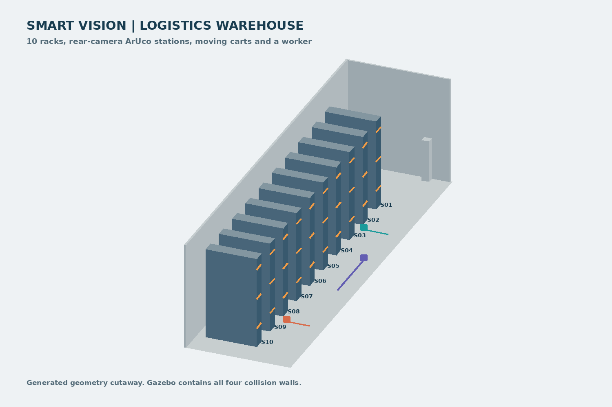

# 물류창고 10개 섹터 · 웹 직접 운용

대형 랙 10개와 세로 주통로, Home 충전 구역, 움직이는 카트·작업자가 있는 Gazebo Classic 월드다. 작업자가 웹에서 재고 요청·초기 위치·출발을 직접 조작한다. 실차 연결은 사용하지 않는다.

| 구성 | 값 |
|---|---|
| 공간 | 약 10×30m, 랙 10개·Sector 1~10·Home 0 |
| 지도 | 월드의 고정 벽·랙·충전대를 기준으로 생성한 5cm 점유 지도 |
| SLAM | 필요 없음. 생성한 지도와 월드가 같은 좌표를 사용 |
| 움직이는 장애물 | 운반 카트 2개·작업자 1개, 실제 Gazebo 충돌 모델 위치 이동 |
| 장애물 지도 반영 | 고정 구조만 저장 지도에 포함. 이동체는 라이다 관측·장애물 기억으로 처리 |
| 제어 | 기존 A*·Nav2·독립 EKF·국소 우회·복구·후방 ArUco·5초 대기 |
| 주행 파라미터 | 현재 실차 YAML 복사본, 원형 반경 22cm, 직진 상한 0.22m/s |
| 격리 | ROS 도메인 178, Gazebo master 11578, 웹 8793 |
| 실차·교실과 구분 | 실차 도메인 16·웹 8790, 교실 시뮬레이션 176·웹 8792와 별도 |

움직이는 모델은 실제 충돌·카메라·라이다에 반영된다. 센서 데이터에 가짜 빨간 점이나 경로를 직접 그리는 방식이 아니다. 이동체는 정해진 경로를 오가며 로봇이 가까우면 양보한다. 작업자 형상은 단순한 기하 모델이며 실제 보행·물류 장비의 동역학을 보장하지 않는다.



위 그림은 생성된 기하의 구성도다. 실제 Gazebo 스크린샷과 구분한다. [정확한 평면도](warehouse_logistics_plan.png)도 제공한다.

## 1. 최초 한 번 · 현재 코드 빌드

기존 `Team2_workspace`에 Gazebo와 TurtleBot3 시뮬레이션 패키지가 설치된 PC 기준이다.

```bash
cd ~/Team2_workspace/src/SMART-VISION-AMR
./scripts/setup_pc_runtime.sh --no-install
```

새 PC에서 가제보 자산이 없으면 먼저 다음을 실행한다. 부족한 시스템 의존성은 이 스크립트가 안내한다.

```bash
cd ~/Team2_workspace/src/SMART-VISION-AMR
./scripts/setup_sim.sh
```

## 2. 터미널 1 · 물류 월드와 주행 시스템

```bash
cd ~/Team2_workspace/src/SMART-VISION-AMR
./scripts/run_warehouse_sim.sh
```

월드·지도·라이다·EKF·AMCL·A*·Nav2·최종 명령 제어와 이동 장애물을 함께 시작한다. 임무는 자동 발행하지 않는다. 처음에는 AMCL 초기 위치를 웹에서 지정해야 한다. 최대 1시간 유지하며 로그 위치는 터미널에 표시한다.

카트·작업자를 움직이지 않는 비교 장면은 다음처럼 시작한다. 기존 실행을 `Ctrl+C`로 종료한 뒤 선택한다.

```bash
./scripts/run_warehouse_sim.sh --static-obstacles
```

## 3. 터미널 2 · 재고·로봇 운용 웹

```bash
cd ~/Team2_workspace/src/SMART-VISION-AMR
./scripts/run_warehouse_web.sh \
  --require-battery-health --minimum-battery-voltage 10.8
```

- [재고 요청](http://127.0.0.1:8793/inventory)
- [로봇 운용](http://127.0.0.1:8793/)
- 접속 코드·도메인 입력: **178**.

다른 휴대폰·컴퓨터에서는 웹을 실행한 PC의 `hostname -I`로 IP를 확인해 `http://PC_IP:8793/` 또는 `/inventory`로 접속한다. ROS와 Gazebo는 로컬에서 처리하고 브라우저가 HTTP로 접속하는 구조다.

물류 운용 지도는 HOME을 왼쪽, S1~S10을 오른쪽으로 가로 표시한다. 표식 이름은
작게 줄이고 전체 이름은 마우스를 올리면 확인할 수 있다. 평면도·원본 지도·경로·차량·
장애물 표시는 함께 회전하며 실제 주행 좌표와 방향은 바뀌지 않는다.

## 4. 터미널 3 · 촬영할 가제보 화면

터미널 1의 월드 기동 후 실행한다.

```bash
cd ~/Team2_workspace/src/SMART-VISION-AMR
./scripts/run_warehouse_view.sh
```

기존 물류 서버에 GUI만 연결한다. 새 `gazebo` 명령으로 두 번째 서버를 시작하지 않는다. 교실과 물류 GUI를 동시에 띄우면 서버·화면을 구분한다. 촬영 PC 부하를 줄이려면 사용하지 않는 교실 시험은 해당 실행 터미널에서 종료한다.

서버 기동 중에 화면 명령을 먼저 실행해도 최대 60초 동안 연결을 기다린다. 시간 초과 시 터미널 1이 종료됐는지와 그 터미널에 출력된 로그 경로를 확인한다. 포트 연결 후에도 실제 장면이 표시될 때까지 로딩 시간이 있을 수 있다.

## 5. 웹 운용 순서

### 촬영 중 외부 조종기로 수동 우회

기존 터미널 1~3을 유지한 채 **터미널 4**에서 실행한다.

```bash
cd ~/Team2_workspace/src/SMART-VISION-AMR
./scripts/run_warehouse_controller.sh
```

조종기 창에 초점을 둔 상태에서 방향키를 누르고 있으면 수동이 우선한다. ↑·↓는 전후진, ←·→는 회전이며 조합하면 곡선으로 움직인다. 놓으면 기존 웹 임무에 제어권을 반환하며 재개 조건을 확인한다. Space·Esc는 비상정지다. 비상정지 해제·초기 위치는 기존 운용 웹에서 처리한다. 기본 수동 상한은 0.12m/s·0.60rad/s다.

조종기는 기존 웹의 제어권 인계를 사용한다. `/cmd_vel`에 직접 발행하는 별도 teleop을 함께 켜지 않는다.

촬영용 관제 화면은 [촬영 보기](http://127.0.0.1:8793/?presentation=1)로 접속하고
`Ctrl+Shift+R`로 새로고침한다. 정상 수동 개입 중에는 “경로 주행 중”이라는 문구를 사용하고
웹 조이스틱 영역을 숨긴다. 실제 제어권·임무 상태·원시 로그는 유지되며 비상정지·센서 오류는
기존대로 표시한다. 자동주행 시험 결과와 수동 보조 촬영은 구분한다.

### 요청부터 주행까지

1. 재고 웹에서 물품과 Sector 1~10 중 목적지를 골라 요청한다.
2. 운용 웹에서 비상정지를 유지한 채 **초기 위치 지정 → 등록 홈에서 시작**을 체크·적용한다.
3. 물류 Home은 **x=2.8m, y=1.0m, yaw=−90°**다. 후방 카메라는 Home 0 마커를 본다. 교실 Home 좌표를 입력하지 않는다.
4. AMCL·TF·센서·출발 준비가 정상으로 확인되면 비상정지를 직접 해제한다.
5. 요청과 적재 확인란을 확인하고 임무를 시작한다. 빈 차 촬영이면 빈 차 시험임을 확인한 뒤 적재 확인을 한다.
6. 섹터까지 주행 → 후방 마커 확인 → 5초 대기 → 다음 섹터 또는 Home 복귀를 관찰한다.

첫 촬영은 Sector 1 또는 2로 시작하고, 이후 1→5→10처럼 이동 거리가 긴 요청을 추가하면 랙 통로·이동 장애물·복귀를 한 장면에서 관찰할 수 있다. 명령 속도는 실차 상한을 유지하므로 30m 창고의 긴 왕복은 교실보다 오래 걸린다.

## 6. 구성 파일과 수정

| 파일 | 역할 |
|---|---|
| `scripts/generate_warehouse_demo.py` | 월드·지도·섹터·마커·장애물 경로를 같은 기하에서 생성 |
| `worlds/warehouse_logistics.world` | 랙·벽·바닥·Home·이동체·마커 모델 |
| `maps/warehouse_logistics.yaml` 및 `.pgm` | 고정 구조 점유 지도 |
| `config/aruco_warehouse_markers.yaml` | Home과 Sector 1~10의 로봇 도착 자세 |
| `config/warehouse_floorplan.yaml` | 웹 표시용 평면도 |
| `config/warehouse_dynamic_routes.yaml` | 이동체 속도·경유점·대기 및 원래 고정 장애물 경계 |
| `scripts/warehouse_dynamic_obstacles.py` | Gazebo 상태 서비스를 이용하는 이동체 제어 |

위 `worlds/`, `maps/`, `config/`는 `ros2_ws/src/smart_vision_amr/` 아래다. 생성기를 변경한 뒤 자산을 다시 만들거나 확인할 수 있다.

```bash
python3 scripts/generate_warehouse_demo.py
python3 scripts/generate_warehouse_demo.py --check
```

월드 파일만 변경하면 저장 지도와 어긋날 수 있으므로 고정 랙·벽은 생성기에서 변경하고 함께 생성한다. 이동체는 계속 저장 지도에서 제외한다.

## 7. 종료와 검증 범위

각 터미널에서 `Ctrl+C`로 종료한다. 터미널 1은 자신이 만든 물류 시뮬레이션과 이동체 프로세스만 정리한다. 다음 재시작에서는 웹 초기 위치를 다시 적용한다.

이 환경은 물류 운용을 설명·시험하기 위한 가상 창고다. 실제 창고의 바닥 미끄러짐, Wi-Fi 지연, 작업자 행동과 지게차 동역학을 실측 재현한 환경은 아니다. 월드 생성·기하 검사와 실제 폐루프 임무 검증은 구분해 기록한다.

### 2026-11-05 확인 결과

| 검증 | 확인 결과 |
|---|---|
| 월드·지도·섹터 기하 | 5셀 팽창 후 Home과 10개 섹터 연결, 고정 지도와 월드 일치 |
| 정적 마커 검사 | ID 0~10 방향·시야·이상적인 320×240 투영 검출 확인 |
| 실제 Gazebo 기동 | map·scan·odom·배터리·카메라 수신, Nav2 활성화 |
| 실제 이동체 | 카트 2개·작업자 1명 각각 위치 갱신과 이동 거리 증가 확인 |
| 실제 후방 카메라 | 렌더링한 Home 프레임에서 OpenCV로 ID 0 검출 |
| 실제 웹 초기화 | 등록 Home 적용 → AMCL·TF VERIFIED, 지도 일치·출발 준비 정상. 비상정지 유지 |
| 실제 웹 섹터 선택 | 재고 요청 메뉴에 Sector 1~10 표시 확인 |
| 가로 지도·촬영 표시 | 원본·평면도 좌표 정렬 CJS 통과, 읽기 전용 기록 데이터로 브라우저 배치 확인. 실제 임무 시험과 구분 |
| 중복 실행 | 전용 잠금으로 기존 물류 실행이 있을 때 새 실행 거부 |
| 전체 섹터 주행·장애물 회피 완주 | 이번 기동 검증에서 미실행. 자동 임무를 발행하지 않음 |

기하·이동체·격리 및 기존 기동 회귀 60개, 웹 관련 Python 회귀 92개를 확인했다. 최초 기동 당시 CJS 단독 검사는 미실행이었고 실제 브라우저에서 섹터 메뉴·Home 초기화·지도·영상 표시를 확인했다. 후속 촬영 보기 작업에서는 Node 런타임으로 물류 메뉴·촬영 표시·장애물 지도·출발 준비 UI 회귀를 통과했다. 초기 actor 실행의 Context/Executor 오류는 수정 후 새 기동에서 재확인했다.

근거: [기동 검증 요약](../benchmarks/warehouse_demo_20261105/smoke_summary.json), [이동체 결과](../benchmarks/warehouse_demo_20261105/dynamic_obstacles_smoke.json), [Gazebo 후방 원본 영상](../benchmarks/warehouse_demo_20261105/gazebo_rear_home.jpg), [웹 Home 검증 화면](../benchmarks/warehouse_demo_20261105/web_home_initialized.jpg). 검증용 실행은 종료했으며 사용자는 위 세 터미널 명령으로 새로 시작한다.
